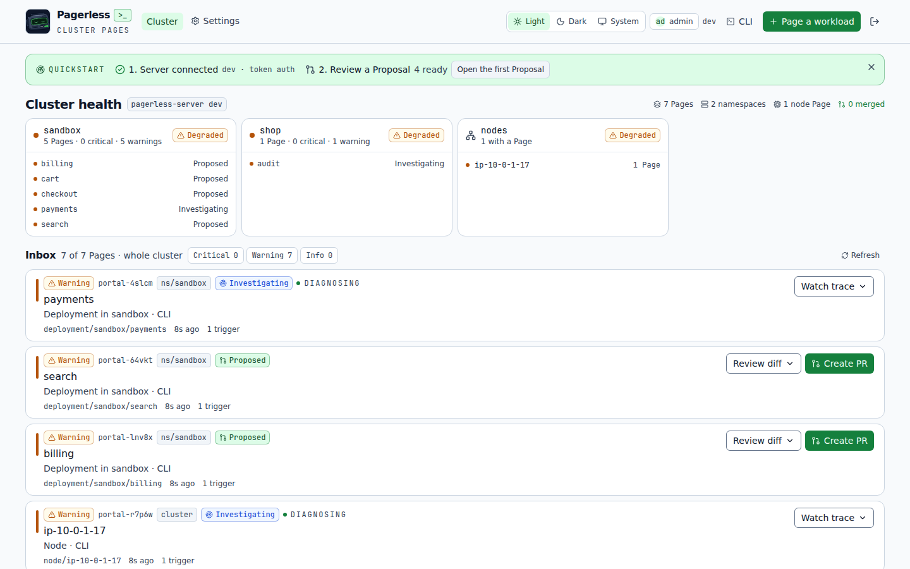
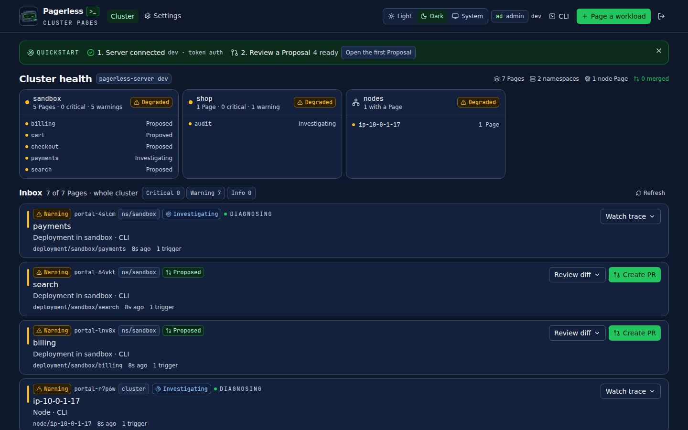
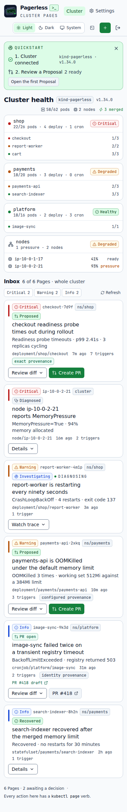
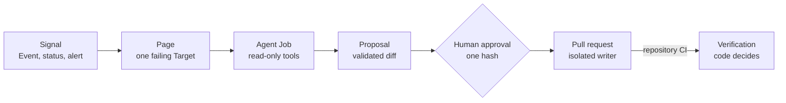

<p align="center">
  _ key" width="128">
</p>

<h1 align="center">Pagerless</h1>

<p align="center">
  <strong>A standalone, read-only Kubernetes remediation operator that turns a failing Target into a diagnosis and one reviewable pull request.</strong>
</p>

<p align="center">
  <a href="https://github.com/a-hagi613/pagerless/actions/workflows/ci.yml"></a>
  <a href="https://github.com/a-hagi613/pagerless/releases"></a>
  <a href="LICENSE"></a>
  <a href="go.mod"></a>
  <a href="https://github.com/a-hagi613/pagerless/pkgs/container/pagerless-server"></a>
  <a href="charts/pagerless"></a>
</p>

Kubernetes failures arrive as alerts, and the repair still starts with a human
reading logs, guessing which repository owns the workload, and writing the patch
by hand. Pagerless turns that into a **Page**: one investigation of one Target,
with a diagnosis, the evidence behind it, and a single reviewable **Proposal**.
A human approves one exact hash, the repository's own CI decides whether the
change may merge, and nothing in Pagerless can change a workload directly.

## The Portal

The Portal is embedded in `pagerless-server` and reads the same Pages the CLI
reads, so the two surfaces cannot disagree about a diagnosis or a decision.

<p align="center">
  
</p>

<p align="center">
  
</p>

<p align="center">
  
</p>

## How it works

1. A Warning Event, a Target status transition, or an authenticated alert from a
   Connector opens or joins the Page for that failure's Fingerprint.
2. The server creates an ephemeral agent Job with a per-Page token and a fixed
   catalogue of read-only tools.
3. The agent reads logs, Events, metrics, and repository files, and returns a
   report that cites the evidence it used.
4. The server validates the Proposal — schema, path policy, identity, and diff
   bounds — and stores it with a hash.
5. A human reviews the diff and approves that exact hash in the Portal or with
   `kubectl page approve`.
6. The isolated writer opens one branch and one pull request against the Target
   Repository. The repository's CI and reviewers decide the merge; after it,
   deterministic checks record whether the Target recovered.



Verification is not the model grading itself: the rollout, the GitOps sync, new
restarts, and the triggering alert are checked by code.

## Install

Pagerless installs into one namespace of a cluster you already run: Kubernetes
1.30 or later, Helm 3.14 or later, and a default StorageClass.

```bash
helm install pagerless oci://ghcr.io/a-hagi613/charts/pagerless \
  --namespace pagerless --create-namespace --version 2.0.0
```

The chart and both images (`pagerless-server` and `pagerless-agent`) are
published at that version. The plugin is published by the same release; once the
`v2.0.0` release is published, install its rendered `page.yaml` asset directly:

```bash
curl -fLO https://github.com/a-hagi613/pagerless/releases/download/v2.0.0/page.yaml
kubectl krew install --manifest=page.yaml
```

The shorter commands below start working once the release's Krew index and
Homebrew formula pull requests are merged upstream:

```bash
kubectl krew install page
brew install a-hagi613/tap/kubectl-page
```

`kubectl page version` prints the plugin, the chart version it expects, and the
Go version. [`docs/install.md`](docs/install.md) covers the namespace allowlist,
an externally managed credentials Secret, rendering the checked-in manifest
template, and uninstall.

The chart installs one `pagerless-server` Deployment, one Service, one
`pagerless-data` PersistentVolumeClaim, two ConfigMaps, two ServiceAccounts, a
`pagerless-credentials` Secret whose fixed keys and webhook tokens are present
and empty, the bootstrap-token and session-key Secrets, the read identity, and an
agent egress NetworkPolicy. It installs no database, identity provider, message
broker, gateway, or admission webhook. The release notes print the sign-in
steps: port-forward the Portal, decode the bootstrap token, sign in at `/login`,
and finish onboarding at `/settings`.

The Target Repository is resolved from `GITHUB_REPO` in the credentials Secret,
using `GITHUB_API_URL` for a GitHub Enterprise host and `https://github.com`
otherwise. Completing the Secret after onboarding is enough: the server re-reads
it when a Page starts and when an approved Proposal is published. An air-gapped
installation that has no repository sets `targetRepository.enabled=false` and
runs diagnose-only.

## One capability, two surfaces

Every Portal action has one CLI verb and every verb has one Portal path; a test
fails the build when the two drift. Both read the same `Page` resource, and both
record the same decision.

| Action | Portal | `kubectl page` |
| --- | --- | --- |
| Open a Page | **Page a workload** | `kubectl page new deployment/checkout -n shop` |
| Read the Proposal | **Review diff** | `kubectl page diff <page>` |
| Approve and open the PR | **Approve & create PR** | `kubectl page approve <page>` |
| Dismiss a Page | **Dismiss** | `kubectl page dismiss <page> --reason "<why>"` |
| Read or change settings | **Settings** | `kubectl page config get`, `config set ai` |

Every command exists in `cmd/kubectl-page`; [`docs/cli.md`](docs/cli.md) lists
each command, flag, exit code, and the two transports.

## The safety model

Pagerless's only change path is one pull request, which it never merges.

- **A read-only cluster identity.** The server can `get`, `list`, and `watch`
  workloads, Events, logs, and the OpenAPI schema, and write only its own Pages,
  the agent Jobs, one token review per agent call, and the credentials Secret.
  It has no write verb on any watched workload and no `exec`, `attach`,
  `port-forward`, `impersonate`, or `bind`. The agent's ServiceAccount holds no
  RBAC at all.
- **An isolated writer.** The GitHub credential lives in `internal/github/pr`,
  which no read path can reach; a dependency test fails if the read client,
  Validation, the Proposal model, or the Page store gains a route to it. The
  writer accepts a server-validated Page identity, approval hash, base commit,
  and file contents, never model text.
- **A human gate.** A decision binds to the hash the human saw. If the Proposal
  changes first, the CLI exits `4` and the Portal answers `409
  proposal_changed`; the repository's CI and reviewers own the merge.
- **Explicitly out of scope.** No auto-merge, no cluster writes, no exec, and no
  bundled platform services — no database, identity provider, message broker,
  gateway, admission webhook, or MCP server — and no sidecar.

The evidence is [ADR-0037](docs/adr/0037-read-only-cluster-identity.md), a chart
test that fails when a rule widens, and `make verify-chart`, which installs the
chart on a throwaway kind cluster and runs `kubectl auth can-i` as the server.

## Connectors

Native Kubernetes logs are always on. Every other backend is opt-in and
read-only, configured with a URL, bounds, and an `auth` reference to the
credentials Secret; alert senders authenticate independently.

| Backend | What it contributes |
| --- | --- |
| Loki | Log queries. |
| Grafana | Logs, and metrics through the datasource proxy or unified query API. |
| CloudWatch | Logs and metrics. |
| Datadog | Logs and metrics, with a shipped webhook template for alerts. |
| OpenSearch | Log queries. |
| Prometheus | Metric queries. |
| Alertmanager | Firing alerts, authenticated with a bearer token. |
| Grafana alerting | Firing alerts, authenticated with an HMAC-SHA256 signature. |
| MCP | Exactly one configured read-only tool per Connector; the tool name never comes from model output. |

[`docs/connectors.md`](docs/connectors.md) documents every key, the webhook
dialects, the subject rules, and the Context Bundle bounds.

## Documentation

| Page | What it answers |
| --- | --- |
| [docs/install.md](docs/install.md) | Prerequisites, watch modes, credentials, verification, uninstall. |
| [docs/onboarding.md](docs/onboarding.md) | The three ways to fill the credentials Secret. |
| [docs/auth.md](docs/auth.md) | Bootstrap token, sessions, CSRF, proxy mode, threat model. |
| [docs/cli.md](docs/cli.md) | Every `kubectl page` command, flag, and exit code. |
| [docs/portal.md](docs/portal.md) | Portal routes, API, and the parity contract. |
| [docs/connectors.md](docs/connectors.md) | Evidence Connectors, alert senders, Context Bundles. |
| [docs/release.md](docs/release.md) | What one tag publishes, and how to verify it. |
| [docs/upgrade.md](docs/upgrade.md) | The full v1 to v2 break. |
| [docs/adr/](docs/adr/README.md) | The decisions that constrain the design. |
| [GLOSSARY.md](GLOSSARY.md) | The vocabulary the code and documentation use exactly. |
| [charts/pagerless/README.md](charts/pagerless/README.md) | Every chart value and rendered object. |

The documentation index is also published as [`docs/README.md`](docs/README.md).

## License

[Apache-2.0](LICENSE). Issues and pull requests are welcome.
