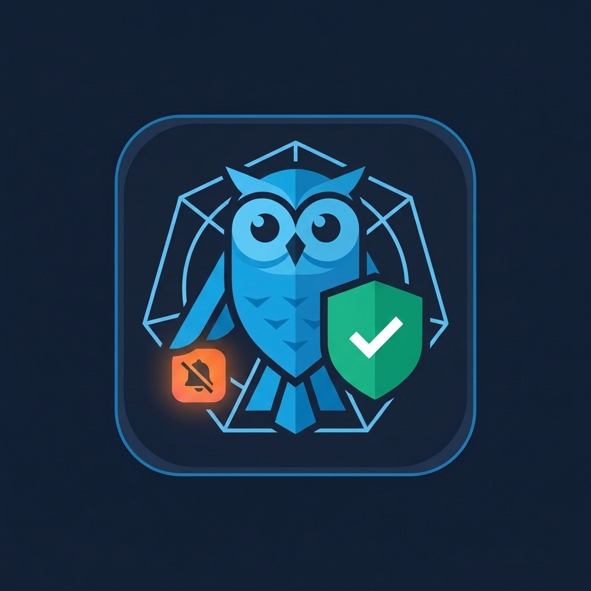
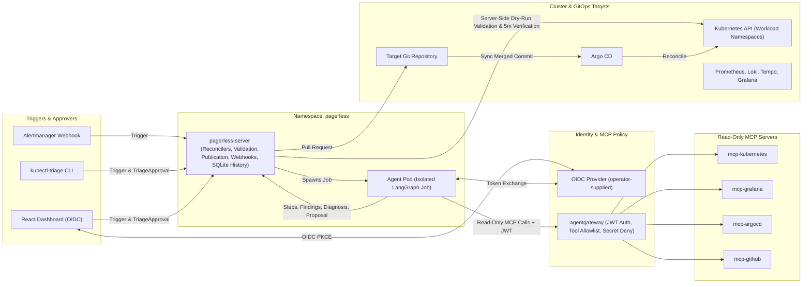
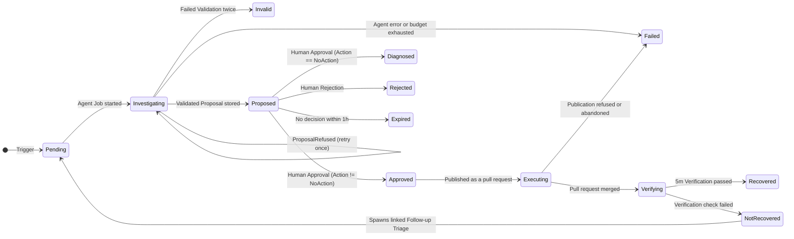

<p align="center">
  
</p>

<h1 align="center">Pagerless</h1>

<p align="center">
  <strong>Human-gated Kubernetes Triage operator that diagnoses failing Workloads through read-only Model Context Protocol (MCP) servers and publishes validated remediations as pull requests only after a hash-bound human Approval.</strong>
</p>

<p align="center">
  <a href="https://github.com/a-hagi613/pagerless/actions/workflows/ci.yml"></a>
  <a href="https://github.com/a-hagi613/pagerless/releases/tag/v1.0.0"></a>
  <a href="charts/pagerless/README.md"></a>
  <a href="go.mod"></a>
  <a href="agent/pyproject.toml"></a>
  <a href="hack/versions.env"></a>
  <a href="LICENSE"></a>
</p>

<p align="center">
  <a href="#what-is-pagerless">What is Pagerless?</a> ·
  <a href="#quick-start">Quick Start</a> ·
  <a href="#architecture">Architecture</a> ·
  <a href="#development">Development</a> ·
  <a href="#safety-boundaries">Safety Boundaries</a> ·
  <a href="GLOSSARY.md">Glossary</a>
</p>

---

## What is Pagerless?

Pagerless is a standalone Kubernetes `Triage` operator for investigating failing `Deployment` and `StatefulSet` **Workloads** on any cluster (`kind`, Amazon EKS, Google Kubernetes Engine, Azure Kubernetes Service, k3s, or bare metal). It separates investigation from mutation so an AI model never holds write credentials or grades its own work:

1. **Read-only investigation.** When a **Trigger** (an opted-in Alertmanager alert or a human request) starts an **Active Triage**, `pagerless-server` launches a zero-RBAC **Agent Pod** (`Job`) that gathers a deterministic **Context Bundle** and queries read-only MCP backends (`k8s`, `grafana`, `argocd`, `github`) behind `agentgateway` and OIDC.
2. **Deterministic `Validation` and hash-bound `TriageApproval`.** The agent submits cited **Findings**, a root-cause **Diagnosis**, and one typed **Proposal** from a fixed **Action** menu. Deterministic Go code in `pagerless-server` runs **Validation** — namespace allowlists, resource/replica bounds, a Kubernetes server-side dry run, and single-file diff rendering — and computes a SHA-256 **Proposal** hash. Execution blocks until an authorized human creates a `TriageApproval` (**Approval** or final **Rejection**) bound to that exact hash, **Workload** generation, and target-repository commit, rejecting any **Stale Proposal**.
3. **Pull request publication and five-minute `Verification`.** After an **Approval**, `pagerless-server` commits the reviewed patch to a branch, opens one auto-merging pull request in the target repository, and records its merge commit. The repository's own CI validates the change. Deterministic Go **Verification** then observes the **Workload** over a five-minute window before recording `Recovered` or `NotRecovered` and generating a purely descriptive post-**Verification** **Narrative**.

The reference demonstration environment — the OpenTelemetry shopping-cart Sandbox, Argo CD, Prometheus, Alertmanager, Grafana, Chaos Mesh, and the Terraform for Amazon EKS — lives in the separate [`a-hagi613/pagerless-sandbox`](https://github.com/a-hagi613/pagerless-sandbox) repository and is a worked example, never an installation dependency.

### Components

| Component | Binary / Runtime | Role | Least-Privilege Boundary |
| --- | --- | --- | --- |
| `pagerless-server` | Go `1.27.4` (`cmd/pagerless-server`) | Reconciles `Triage` and `TriageApproval` custom resources, runs pre-approval **Validation**, publishes pull requests, runs five-minute **Verification**, serves admission webhooks and the embedded dashboard, and persists SQLite history. | Read-only on Pods; `update` on Deployments and StatefulSets is restricted to server-side dry runs (`dryRun=All`) by a `ValidatingAdmissionPolicy`; spawned **Agent Pods** are locked to the `pagerless-agent` ServiceAccount. |
| `pagerless-agent` | Python `3.14` / LangGraph (`agent/`) | Ephemeral **Agent Pod** (`Job`) that assembles the **Context Bundle**, queries read-only MCP tools, streams step events, submits **Findings**, **Diagnosis**, and **Proposal**, and writes the post-**Verification** **Narrative**. | Zero Kubernetes RBAC (`automountServiceAccountToken: false`); reaches MCP servers only through `agentgateway` using a federated OIDC token that enforces tool allowlists and denies `Secret` reads. |
| `kubectl-triage` & Dashboard | Go `1.27.4` (`cmd/kubectl-triage`) & React/TypeScript (`dashboard/`) | Operator CLI plugin and OIDC web UI for starting a **Triage** (with an optional **Hint**), watching live investigation steps, reviewing rendered diffs, and recording a hash-bound `TriageApproval`. | CLI uses the operator's Kubernetes RBAC (`Role pagerless-approver`); the dashboard authenticates through OIDC (PKCE) and asserts `pagerless-approvers` membership without Kubernetes impersonation. |

### Supported `Action`s

| `Action` | Required Mode | Publication Path | Deterministic `Verification` Criteria (5-Minute Window) |
| --- | --- | --- | --- |
| `Scale` | Target repository (`sandbox.url` set) | Opens a single-file pull request updating `spec.replicas`, validated within `1..10` and a server-side dry run. | `ArgoCDSynced` at the merge commit, `RolloutAvailable`, `NoNewRestarts`, and `AlertResolved`. |
| `PatchResources` | Target repository (`sandbox.url` set) | Opens a single-file pull request updating one container's CPU/memory `requests` and `limits`, validated within `10m..4` CPU, `16Mi..8Gi` memory, `requests <= limits`, and a server-side dry run. | `ArgoCDSynced` at the merge commit, `RolloutAvailable`, `NoNewRestarts`, and `AlertResolved`. |
| `Rollback` | Target repository (`sandbox.url` set) | Opens a single-file pull request reverting one commit on the **Workload** manifest or a path in `pagerless.dev/depends-on-paths`, validated via a server-side dry run. | `ArgoCDSynced` at the merge commit, `RolloutAvailable`, `NoNewRestarts`, and `AlertResolved`. |
| `NoAction` | Live-only or target repository | No mutation; human **Approval** acknowledges an external cause (such as an active Chaos Mesh **Experiment**) outside the **Workload** manifests. | Transitions directly from `Proposed` to terminal **Phase** `Diagnosed` upon **Approval** (`Verification` outcome `NotApplicable`). |

## Quick start

Install the chart into a cluster you already run, then trigger, inspect, and approve a **Triage** with `kubectl triage`:

```bash
# From a checkout, with the values your cluster needs (OIDC, inference, connectors):
helm upgrade --install pagerless ./charts/pagerless \
  --namespace pagerless --create-namespace \
  --values my-values.yaml

# Or let the installer apply the CRDs, create the agent credentials Secret from
# the environment, and run helm for you:
bash hack/install.sh --context my-cluster --namespaces payments,checkout --provider anthropic --yes

# Start a Triage, stream live investigation steps, and record a hash-bound Approval:
kubectl triage --context my-cluster --namespace payments deploy/my-service --hint "check recent restarts"
TRIAGE="$(kubectl triage --context my-cluster list | awk 'NR==2 {print $1}')"
kubectl triage --context my-cluster show "$TRIAGE" --watch
kubectl triage --context my-cluster approve "$TRIAGE"
```

The chart expects an OIDC provider, an MCP gateway, and the integration Secrets to exist already. The [chart reference](charts/pagerless/README.md) lists every value, and [`docs/install.md`](docs/install.md) lists the prerequisites in full.

## Architecture



### Triage Phase lifecycle



## Development

Development runs on a Linux host with Docker, `kind`, `kubectl`, and Helm at the versions pinned in [`hack/versions.env`](hack/versions.env). The full local loop is:

```bash
make preflight          # check the pinned tools and the Docker memory floor
make dev                # build the images, load them into kind, install the chart
make dashboard-preview  # serve the seeded dashboard without a cluster
make down               # delete the development kind cluster
```

Every change lands through a pull request gated by CI:

- `make lint` (`make lint-go`, `make lint-agent`): `go vet`, `golangci-lint`, `ruff`, and strict `mypy`.
- `make test` (`make test-go`, `make test-agent`): the Go `envtest` suites and the Python agent suite (deterministic, no paid call).
- `make dashboard-check` / `make dashboard-build`: TypeScript typechecking, ESLint, and the production Vite build embedded into `pagerless-server`.
- `make validate`: `helm lint` and the pinned `kubeconform` over the chart's renderings.

The Go envtest harness renders `charts/pagerless` and applies it to a real API server, so the chart's RBAC, admission policies, and webhook configuration are exercised by the same suite that tests the server.

## Safety boundaries

The model proposes; deterministic code decides.

- **Zero Kubernetes RBAC for the agent:** the `pagerless-agent` ServiceAccount holds no Kubernetes API permissions. The `mcp-kubernetes` ServiceAccount is restricted to read-only access on allowlisted namespaced resources and pod logs; it cannot read `Secret` objects, `exec`, proxy, or port-forward.
- **Per-call gateway authentication and authorization ([ADR-0022](docs/adr/0022-agentgateway-is-the-only-mcp-caller.md)):** every MCP call presents a short-lived OIDC token obtained via projected ServiceAccount token exchange. `agentgateway` validates the token against the issuer's JWKS, strips it before forwarding, enforces per-server tool allowlists, and denies any `resources_get` or `resources_list` call whose arguments reference a `Secret`.
- **One pull request, one file:** a **Proposal** renders exactly one manifest change. `pagerless-server` commits that patch to a branch and opens one pull request; it never writes to the cluster.
- **Dry-run-only server validation:** a `ValidatingAdmissionPolicy` restricts `pagerless-server` updates on **Workloads** to server-side dry runs (`dryRun=All`).
- **Hash-bound `TriageApproval`:** **Approval** and **Rejection** contend for one canonical `TriageApproval` resource name per **Triage** and bind to the exact **Proposal** hash, **Workload** generation, and target-repository commit. A change to any of them makes the **Proposal** stale and refuses the decision.
- **Bounded budgets and untrusted evidence wrapping:** each investigation is capped at 15 tool calls, 5 minutes, and roughly 300,000 input tokens (including cached input). All tool outputs and **Context Bundle** sections are truncated, sanitized against Markdown/fence injection, and wrapped in `<tool_output>` delimiters as untrusted data.
- **Deterministic Verification ([ADR-0006](docs/adr/0006-verification-is-decided-by-code.md)):** Go code — never the model — decides whether a **Workload** is `Recovered` or `NotRecovered` after the five-minute observation window. Unavailable telemetry APIs never count as recovery.

## History, retention, and metrics

`pagerless-server` records an append-only SQLite snapshot (persisted on a `PersistentVolumeClaim`) on every **Phase** transition and every step event. The retention controller deletes terminal `Triage` custom resources seven days after `status.terminalAt` while preserving their complete SQLite history for the dashboard.

On port `9090`, `pagerless-server` exports Prometheus metrics for **Triages** by **Phase**, **Proposals** by **Action**, human decisions, **Verification** outcomes, time to `Recovered`, and token usage and cost per **Triage**, charted by the **Pagerless** dashboard that ships in [`charts/pagerless/dashboards`](charts/pagerless/dashboards/pagerless.json).

## CLI reference

- `kubectl triage <pod/name | deploy/name | sts/name>` starts or joins an **Active Triage** (resolving pods to their owning **Workload**); `--namespace` selects the **Workload** namespace and `--hint` attaches a human **Hint**.
- `kubectl triage list` lists **Triages** (`-o json` and `-o yaml` return structured output).
- `kubectl triage show <name>` displays cited **Findings**, the **Diagnosis**, the **Proposal** and rendered diff, execution details, **Verification** checks, and the **Narrative** (`-o json` and `-o yaml` supported).
- `kubectl triage show <name> --watch` streams live investigation steps until `Proposed` or a terminal **Phase**.
- `kubectl triage approve <name>` reviews the rendered change and creates a hash-bound `TriageApproval` (`--yes` skips the interactive prompt).
- `kubectl triage reject <name> --reason "<explanation>"` records a final **Rejection**.

## Documentation

- [Glossary](GLOSSARY.md): canonical domain vocabulary used across code and docs.
- [Standalone cluster installation](docs/install.md): installing Pagerless into any Kubernetes cluster with the Helm chart or `make install`.
- [Helm chart reference](charts/pagerless/README.md): every value of the standalone `charts/pagerless` release.
- [Dashboard guide and HTTP API](docs/dashboard.md): OIDC sign-in, `RealmProxy()`, asserted-approver decisions, SSE streaming, and Grafana embedding.
- [Architecture Decision Records](docs/adr/README.md): ADRs 0001–0027 documenting key architectural trade-offs.
- Component guides: [Agent runtime & Replay](agent/README.md).

## License

Licensed under the [Apache License, Version 2.0](LICENSE).
