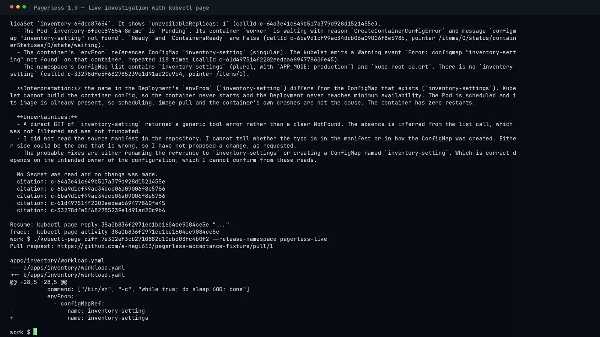
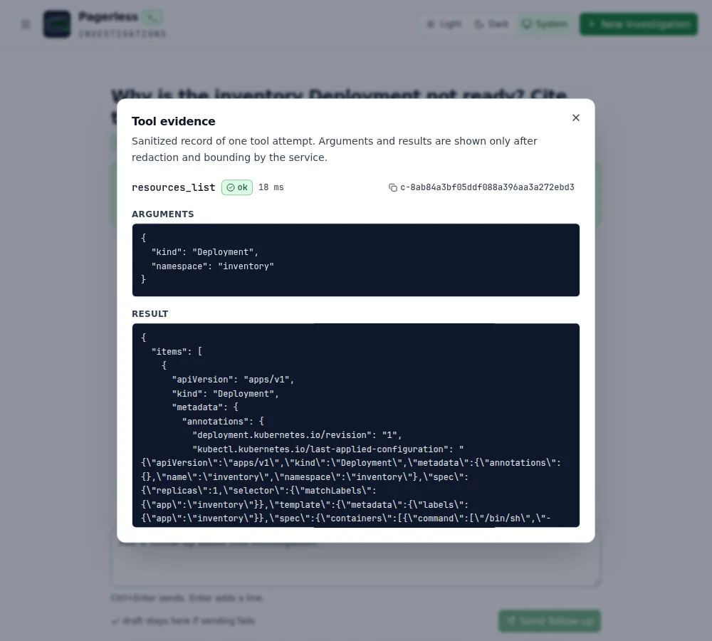

# Pagerless

**Read-only Kubernetes investigations with cited evidence and human-reviewed draft pull requests.**

[](https://github.com/a-hagi613/pagerless/actions/workflows/ci.yml)
[](LICENSE)


Pagerless answers the question an on-call engineer actually asks: *why is this workload failing?*
It reads the cluster and the repository that owns its configuration, shows every read it made,
cites the objects and files behind each claim, and opens a **draft** pull request when the evidence
supports a change. It cannot write to the cluster and it never merges.

https://github.com/user-attachments/assets/44875625-1ea1-4eab-8bc5-f0606b5c7a32

*Dashboard recording (52 s): a real Haiku turn with formatted Markdown, live tool calls, sanitized evidence and a proposed diff.*

https://github.com/user-attachments/assets/9ffda7da-f6ba-4576-a6cd-07523c49d270

*CLI recording (43 s): the same investigation from a colour terminal, with tool statuses, citations and the proposed diff.*

The recordings are real interactions against a real installation, not a mock or a replayed
transcript. [What the demo shows](docs/demo.md) explains the environment and the verification.

## Why it exists

- **Evidence first.** The transcript keeps the tool, arguments, status, duration and a bounded,
  redacted result for every attempt. Answers cite calls and JSON pointers; the dashboard and CLI
  open the same evidence.
- **Read-only by construction.** A dedicated Kubernetes identity can get, list, read events and
  read bounded logs. Secrets, exec, attach, proxy and every mutating verb are denied. Discovery of
  a resource never grants permission to read it.
- **No cluster writes.** A proposal is a branch and a draft pull request against the repository you
  configured. The publisher verifies the base commit, the repository and the allowed path before
  it writes. A human merges.
- **One conversation, two interfaces.** Start in the terminal and resume in the browser. Both
  clients use the same API, the same ordered event log and the same history.

## Install

Tested on a single-node [kind](https://kind.sigs.k8s.io/) cluster with **Kubernetes 1.37.0**,
kind **v0.33.0**, Helm **4.3.2** and a 5 GiB persistent volume. The chart requires Kubernetes
1.29 or newer.

You need:

- a Kubernetes cluster and `kubectl` access to install a release;
- an OpenAI-compatible Chat Completions endpoint whose model supports tool calls;
- a GitHub repository that holds the cluster's source configuration;
- a StorageClass that can bind a 5 GiB claim (or an existing claim).

### 1. Create the credentials Secret

The chart never creates or edits a Secret. Create one namespace and one Secret first. The random
internal tokens are generated in place, and the three supplied values are read without echo, so
none of them enters your shell history.

```sh
kubectl create namespace pagerless

read -rsp 'Model API key: ' PAGERLESS_MODEL_KEY; echo
read -rsp 'GitHub read token: ' PAGERLESS_GH_READ; echo
read -rsp 'GitHub write token: ' PAGERLESS_GH_WRITE; echo

kubectl --namespace pagerless create secret generic pagerless-credentials \
  --from-literal=operator-token="$(openssl rand -hex 32)" \
  --from-literal=internal-token="$(openssl rand -hex 32)" \
  --from-literal=mcp-token="$(openssl rand -hex 32)" \
  --from-literal=github-read-token="$PAGERLESS_GH_READ" \
  --from-literal=github-write-token="$PAGERLESS_GH_WRITE" \
  --from-literal=model-api-key="$PAGERLESS_MODEL_KEY"

unset PAGERLESS_MODEL_KEY PAGERLESS_GH_READ PAGERLESS_GH_WRITE
```

Use two fine-grained GitHub tokens scoped to the one configuration repository:

| Secret key | GitHub permission |
| --- | --- |
| `github-read-token` | **Contents: Read** |
| `github-write-token` | **Contents: Read and write** and **Pull requests: Read and write** |

The write token is held only by the publisher. The agent never sees either GitHub token, the
Kubernetes credential or the model key.

### 2. Write values

```yaml
existingSecret: pagerless-credentials

model:
  # The acceptance run used Anthropic's OpenAI-compatible endpoint.
  # Any endpoint and tool-calling model that speaks Chat Completions works.
  baseUrl: https://api.anthropic.com/v1
  name: claude-haiku-5-5

github:
  repository: your-org/your-cluster-config
  baseBranch: main
  # Optional: bound reads and proposals to one directory.
  # pathPrefix: clusters/production

kubernetes:
  # Install one read-only Role per namespace instead of a ClusterRole.
  # Leave empty to allow read-only access to every namespace.
  namespaceAllowlist: [shop]
```

### 3. Install the chart

```sh
helm install pagerless \
  oci://ghcr.io/a-hagi613/pagerless/core/charts/pagerless \
  --version 1.0.1 \
  --namespace pagerless \
  --values values.yaml
```

If the OCI chart is not anonymously readable in your environment, install the same chart from the
GitHub Release asset:

```sh
helm install pagerless \
  https://github.com/a-hagi613/pagerless/releases/download/pagerless-v1.0.1/pagerless-1.0.1.tgz \
  --namespace pagerless \
  --values values.yaml
```

The image defaults are `ghcr.io/a-hagi613/pagerless/core/server:1.0.1` and
`ghcr.io/a-hagi613/pagerless/core/agent:1.0.1` for `linux/amd64` and `linux/arm64`.

### 4. Wait for readiness, then open the dashboard

The pod stays unready until each prerequisite answers. Readiness distinguishes a reachable model
endpoint from a successful tool-calling probe and authorized repository access, and it never
prints a credential or creates a test pull request.

```sh
kubectl --namespace pagerless get pods
kubectl --namespace pagerless port-forward service/pagerless-server 8080:8080
curl --silent http://localhost:8080/readyz
```

Readiness names the failing check. Correct the value and run `helm upgrade` with the same release.
A bad model key, a model without tool calling, a wrong repository or a missing read-only grant each
show up as a separate failing check.

Open <http://localhost:8080> and paste the operator token. The browser exchanges it once for an
HttpOnly, SameSite=Strict session cookie; the token is never written to local storage.

```sh
kubectl --namespace pagerless get secret pagerless-credentials \
  --output jsonpath='{.data.operator-token}' | base64 --decode
```

The token is printed only to this terminal. Use a private shell and do not paste it into a command
line or a chat. The dashboard's history is shared by everyone authorized for the installation.

### 5. Install the CLI

The release carries `kubectl-page` archives for Linux and macOS on amd64 and arm64, one SBOM per
archive, and `checksums.txt`.

```sh
base=https://github.com/a-hagi613/pagerless/releases/download/pagerless-v1.0.1
curl -fsSLO "$base/checksums.txt"
curl -fsSLO "$base/kubectl-page_1.0.1_linux_amd64.tar.gz"
sha256sum --check --ignore-missing checksums.txt
tar -xzf kubectl-page_1.0.1_linux_amd64.tar.gz
mkdir -p "$HOME/.local/bin"
install -m 0755 kubectl-page "$HOME/.local/bin/kubectl-page"
```

Or install the Krew manifest attached to the same release:

```sh
base=https://github.com/a-hagi613/pagerless/releases/download/pagerless-v1.0.1
kubectl krew install --manifest="$base/page.yaml"
```

The plugin discovers the installed Service from the current kube context. Pass
`--release-namespace pagerless` if the release is not in the namespace the plugin finds first.
The operator token is read from `PAGERLESS_TOKEN_FILE` or from standard input with `--token-file -`;
it is never a flag value and never appears in a URL.

## Use it

### Terminal

The command streams each model decision, tool call, duration and citation, then prints the answer.
Keep the token off disk and out of history by piping the Secret read directly into the command:

```sh
kubectl --namespace pagerless get secret pagerless-credentials \
  --output jsonpath='{.data.operator-token}' | base64 --decode |
  kubectl page "Why is the inventory Deployment not ready?" -n inventory --token-file -
```



Colour is automatic on a terminal: tool statuses, headings and diffs are highlighted, while a pipe,
a redirect, `NO_COLOR` or `TERM=dumb` keeps the exact plain output.

Use `kubectl page list`, `show`, `follow`, `activity`, `evidence`, `diff`, `reply` and `stop` to
resume or inspect the same page later. Ctrl-C detaches the stream without stopping the turn;
`kubectl page stop` is the explicit cancellation.

### Dashboard

Open the port-forward and sign in. Start a question with an optional namespace or resource hint,
watch the activity list fill in, open any citation to read the sanitized evidence, and review the
proposed change without leaving the page. On a narrow screen the history moves into a sheet and the
same calls, evidence and diff remain available.


<table role="presentation">
  <tr>
    <td width="50%">
      
    </td>
    <td width="50%">
      
    </td>
  </tr>
</table>

## Read-only guarantees

The cluster identity is a dedicated ServiceAccount bound to a read-only Role or ClusterRole:
`get` and `list` on the approved API groups, plus events and bounded pod logs. Secret reads,
exec, attach, port-forward and every write verb are denied, and a negative test exercises the
grant. The agent holds no Kubernetes credential: the server forwards each approved call, so policy,
redaction and the transcript stay in one place.

Model output, workload text, logs and source files are untrusted data. They are sanitized and
bounded before the model, the transcript or the browser sees them. The dashboard parses answers as
Markdown into React elements, skips raw HTML and restricts links to explicit safe schemes.

## Proposals are draft pull requests

A proposal names the repository and a verified base commit, and may change only files inside the
configured path. Pagerless validates the diff, creates a branch, commits through the
publisher token and opens a **draft** pull request with the question, findings, evidence references
and expected effect. It never pushes to the default branch, never force-pushes and never merges.
A retry recovers the branch and pull request it already created; an ambiguous source or a moved
base is explained instead of guessed.

## Demo and verification

The dashboard and CLI recordings were made on a single-node kind cluster running Kubernetes 1.37.0,
with the real `pagerless` chart, the real `claude-haiku-5-5` model and a private acceptance
repository. The investigation in each video is a fresh model turn with live tool calls; the videos
are not scripted transcripts.

CI is different on purpose: the test suite uses a deterministic OpenAI-compatible fixture, so every
check runs without a model key, a cloud account or a live repository. A passing CI badge proves the
deterministic contract, not the recorded model output. [docs/demo.md](docs/demo.md) lists the
recorded environment, the frames inspected, and how to reproduce the recordings privately.

## Architecture


The server holds the cluster, model and publisher credentials. The agent receives only an internal
token and the tool catalogue; every read passes back through the server's policy, redaction and
transcript. The publisher is a separate code path with its own token. The model never receives any
credential.

## Documentation

- [What the demo shows](docs/demo.md): environment, real versus fixture, verification and privacy.
- [Release notes for 1.0.1](docs/release-notes/1.0.1.md): coordinates, images, CLI archives and
  verification.
- [Release engineering](docs/release.md): the immutable tag, the workflow and owner actions.
- [Investigation API](docs/investigation-api.md): pages, turns, events, evidence and publication.
- [Architecture decision](docs/adr/0001-investigation-service.md): runtime and permission
  boundaries.
- [Release specification](docs/specification.md): installation, investigation, interfaces and
  acceptance gates.

## Development

The full checks run in GitHub Actions. Locally, the fast loop is:

```sh
make dashboard-check   # typecheck, lint and unit tests
make test              # Go and Python suites
make validate          # Helm lint, render and kubeconform
make verify-chart      # install the packaged chart on kind and run the integration suite
make lint              # go vet, golangci-lint, ruff and mypy
```

`make verify-chart` needs Docker, kind and Helm; it creates its own cluster and deletes it. No step
needs a maintainer model key or a cloud account.

## License

Pagerless is created and maintained by [a-hagi613](https://github.com/a-hagi613) and distributed
under the [Apache License 2.0](LICENSE).
