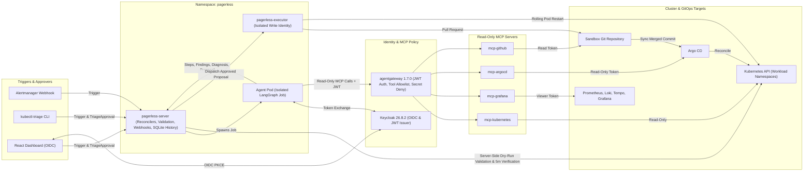
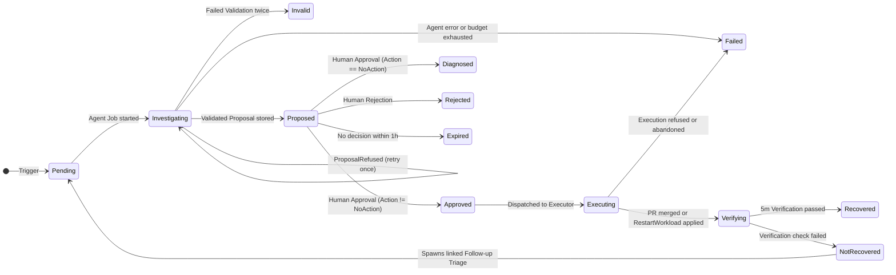
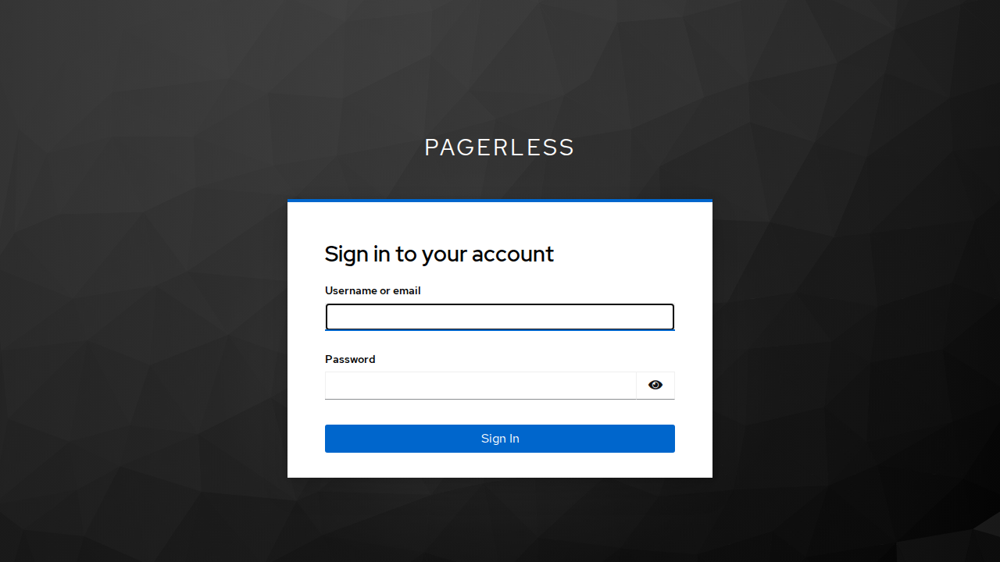
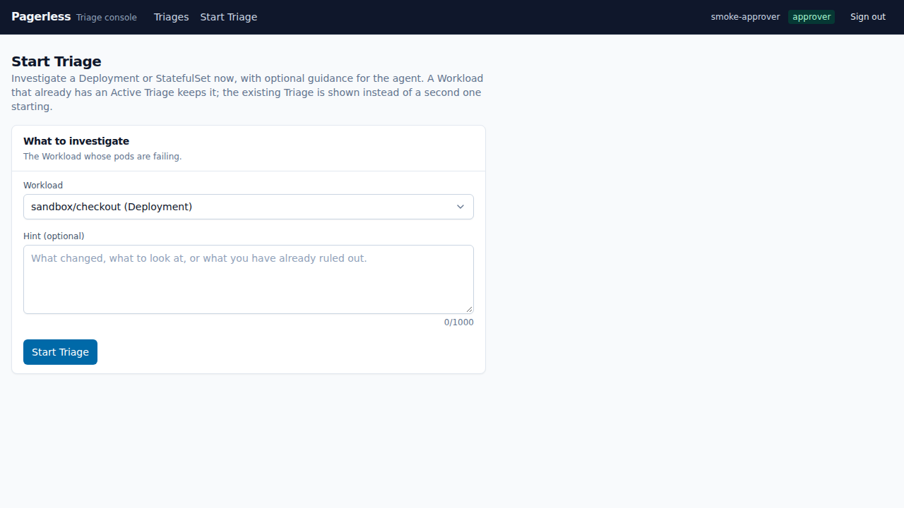
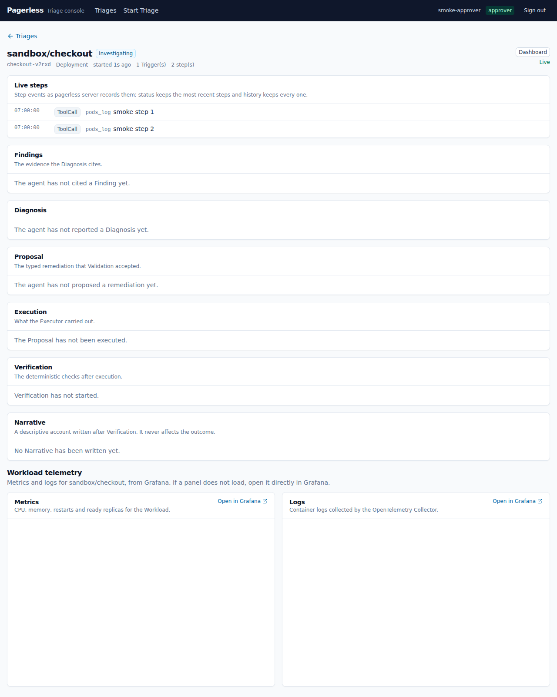
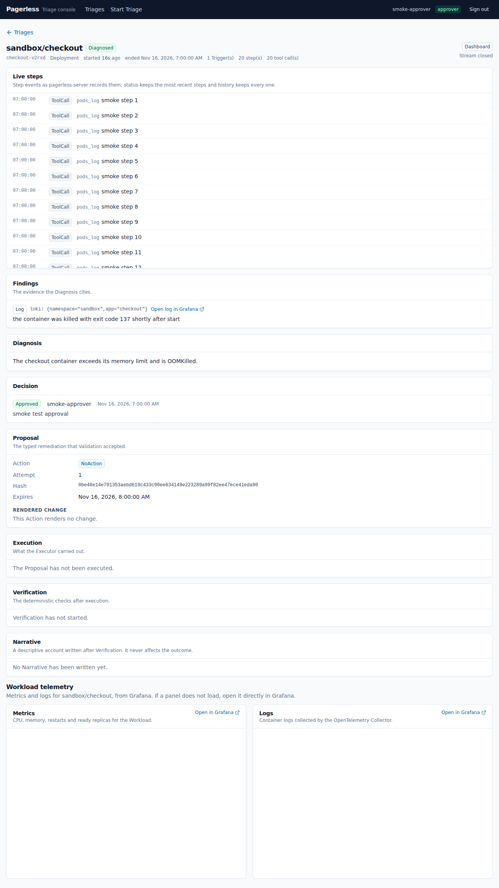

<p align="center">
  
</p>

<h1 align="center">Pagerless</h1>

<p align="center">
  <strong>Human-gated Kubernetes Triage operator that diagnoses failing Workloads through read-only Model Context Protocol (MCP) servers and executes validated remediations only after a hash-bound human Approval.</strong>
</p>

<p align="center">
  <a href="https://github.com/a-hagi613/pagerless/actions/workflows/ci.yml"></a>
  <a href="https://github.com/a-hagi613/pagerless/actions/workflows/infra.yml"></a>
  <a href="https://github.com/a-hagi613/pagerless/releases/tag/v1.0.0"></a>
  <a href="charts/pagerless/README.md"></a>
  <a href="go.mod"></a>
  <a href="agent/pyproject.toml"></a>
  <a href="hack/versions.env"></a>
  <a href="LICENSE"></a>
</p>

<p align="center">
  <a href="#what-is-pagerless">What is Pagerless?</a> ·
  <a href="#60-second-quick-start">Quick Start</a> ·
  <a href="#end-to-end-demo-eks--amazon-nova-2-lite">Live Demo</a> ·
  <a href="#architecture-and-triage-lifecycle">Architecture</a> ·
  <a href="#getting-started">Getting Started</a> ·
  <a href="#dashboard">Dashboard</a> ·
  <a href="#safety-boundaries">Safety Boundaries</a> ·
  <a href="#evaluation">Evaluation</a> ·
  <a href="GLOSSARY.md">Glossary</a>
</p>

---

## What is Pagerless?

Pagerless is a standalone Kubernetes `Triage` operator for investigating and remediating failing `Deployment` and `StatefulSet` **Workloads** on any cluster (`kind`, Amazon EKS, Google Kubernetes Engine, Azure Kubernetes Service, k3s, or bare metal). It separates investigation from mutation so an AI model never holds write credentials or grades its own work:

1. **Read-only MCP investigation.** When a **Trigger** (an opted-in Alertmanager alert or a human request) starts an **Active Triage**, `pagerless-server` launches a zero-RBAC **Agent Pod** (`Job`) that gathers a deterministic **Context Bundle** and queries read-only Model Context Protocol (MCP) backends (`k8s`, `grafana`, `argocd`, `github`) behind `agentgateway` and Keycloak JWT authorization.
2. **Deterministic `Validation` and hash-bound `TriageApproval`.** The agent submits cited **Findings**, a root-cause **Diagnosis**, and one typed **Proposal** from a fixed **Action** menu. Deterministic Go code in `pagerless-server` runs **Validation** — enforcing namespace allowlists, resource/replica bounds, a Kubernetes server-side dry run, and single-file diff rendering — and computes a SHA-256 **Proposal** hash. Execution blocks until an authorized human creates a `TriageApproval` (**Approval** or final **Rejection**) bound to that exact hash, **Workload** generation, and **Sandbox** commit (rejecting any **Stale Proposal**).
3. **Isolated `Executor` and 5-minute `Verification`.** The separate `pagerless-executor` binary independently re-verifies the `TriageApproval` and **Proposal** hash, applies the approved **Action** (as a GitOps pull request or a live rolling pod replacement), and hands off to deterministic Go **Verification**, which observes the **Workload** over a five-minute window before recording `Recovered` or `NotRecovered` and generating a purely descriptive post-**Verification** **Narrative**.

The reference demonstration environment — the OpenTelemetry shopping-cart **Sandbox**, Argo CD, Prometheus, Alertmanager, Grafana, and Chaos Mesh — lives in the separate [`a-hagi613/pagerless-sandbox`](https://github.com/a-hagi613/pagerless-sandbox) repository and is a worked example, never an installation dependency.

### Components

| Component | Binary / Runtime | Role | Least-Privilege Boundary |
| --- | --- | --- | --- |
| `pagerless-server` | Go `1.27.4` (`cmd/pagerless-server`) | Reconciles `Triage` and `TriageApproval` custom resources, runs pre-approval **Validation** and five-minute **Verification**, serves admission webhooks and the embedded dashboard, and persists SQLite history. | Read-only on Pods; `update` on Deployments and StatefulSets is restricted to server-side dry runs (`dryRun=All`) by a `ValidatingAdmissionPolicy`; spawned **Agent Pods** are locked to the `pagerless-agent` ServiceAccount. |
| `pagerless-executor` | Go `1.27.4` (`cmd/pagerless-executor`) | Isolated write-privileged **Executor** that independently re-verifies the `TriageApproval` and **Proposal** SHA-256 hash before opening a GitOps pull request or performing a live rolling pod replacement. | Sole holder of the GitHub write token (`github-write`) and Pod `delete` RBAC in allowlisted **Workload** namespaces; holds no model credentials or `Triage` status write permissions. |
| `pagerless-agent` | Python `3.14` / LangGraph (`agent/`) | Ephemeral **Agent Pod** (`Job`) that assembles the **Context Bundle**, queries read-only MCP tools, streams step events, submits **Findings**, **Diagnosis**, and **Proposal**, and writes the post-**Verification** **Narrative**. | Zero Kubernetes RBAC (`automountServiceAccountToken: false`); reaches MCP servers only through `agentgateway` using a federated Keycloak JWT that enforces tool allowlists and denies `Secret` reads. |
| `kubectl-triage` & Embedded Dashboard | Go `1.27.4` (`cmd/kubectl-triage`) & React/TypeScript (`dashboard/`) | Operator CLI plugin and OIDC web UI for starting a **Triage** (with an optional **Hint**), watching live investigation steps, reviewing rendered diffs, and recording a hash-bound `TriageApproval`. | CLI uses the operator's Kubernetes RBAC (`Role pagerless-approver`); dashboard authenticates via Keycloak OIDC (PKCE) and asserts `pagerless-approvers` membership verified by the validating admission webhook without Kubernetes impersonation. |

### Supported `Action`s

| `Action` | Required Mode | Execution Path (`pagerless-executor`) | Deterministic `Verification` Criteria (5-Minute Window) |
| --- | --- | --- | --- |
| `RestartWorkload` | Live-only or GitOps | Replaces the target **Workload**'s pods one at a time via the Kubernetes API, waiting for each replacement before deleting the next pod. | `RolloutAvailable`, `NoNewRestarts`, `AlertResolved` (when triggered by Alertmanager), and `ArgoCDSynced` (when an Argo CD Application is configured). |
| `Scale` | GitOps PR (`sandbox.url` set) | Opens a single-file pull request updating `spec.replicas` (validated within `1..10` and Kubernetes server-side dry run); Argo CD reconciles the merged commit. | `ArgoCDSynced` at the merge commit, `RolloutAvailable`, `NoNewRestarts`, and `AlertResolved`. |
| `PatchResources` | GitOps PR (`sandbox.url` set) | Opens a single-file pull request updating one container's CPU/memory `requests` and `limits` (validated within `10m..4` CPU, `16Mi..8Gi` memory, `requests <= limits`, and server-side dry run); Argo CD reconciles the merge. | `ArgoCDSynced` at the merge commit, `RolloutAvailable`, `NoNewRestarts`, and `AlertResolved`. |
| `Rollback` | GitOps PR (`sandbox.url` set) | Opens a single-file pull request reverting one commit on the **Workload** manifest or a path in `pagerless.dev/depends-on-paths` (validated via server-side dry run); Argo CD reconciles the merge. | `ArgoCDSynced` at the merge commit, `RolloutAvailable`, `NoNewRestarts`, and `AlertResolved`. |
| `NoAction` | Live-only or GitOps | No mutation; human **Approval** acknowledges an external cause (such as an active Chaos Mesh **Experiment**) outside the **Workload** manifests. | Transitions directly from `Proposed` to terminal **Phase** `Diagnosed` upon **Approval** (`Verification` outcome `NotApplicable`). |

### 60-second quick start

Install the standalone Helm chart from GHCR (or run `bash hack/install.sh` to bootstrap Keycloak, `agentgateway`, and the chart together), then trigger, inspect, and approve a **Triage** with `kubectl triage`:

```bash
# Option 1: Install the standalone OCI Helm chart (when OIDC, gateway, and Secrets exist)
helm upgrade --install pagerless oci://ghcr.io/a-hagi613/charts/pagerless \
  --version 1.0.0 \
  --namespace pagerless --create-namespace \
  --values my-values.yaml

# Option 2: Batteries-included bootstrap (Keycloak + agentgateway + Pagerless chart)
export ANTHROPIC_API_KEY="sk-ant-..."
bash hack/install.sh --context my-cluster --namespaces payments,checkout --provider anthropic --yes

# Start a Triage, stream live investigation steps, and record a hash-bound Approval
kubectl triage --context my-cluster --namespace payments deploy/my-service --hint "check recent restarts"
TRIAGE="$(kubectl triage --context my-cluster list | awk 'NR==2 {print $1}')"
kubectl triage --context my-cluster show "$TRIAGE" --watch
kubectl triage --context my-cluster approve "$TRIAGE"
```

## End-to-end demo (EKS + Amazon Nova 2 Lite)

The recording below captures a complete live **Triage** on Amazon EKS (`pagerless-eks`) powered by Amazon Nova 2 Lite on Amazon Bedrock via EKS Pod Identity, recorded with [`docs/demo/pagerless.tape`](docs/demo/pagerless.tape) ([reproduction instructions](docs/demo/README.md)):

<p align="center">
  
</p>

> **Full-resolution video:** [`docs/demo/pagerless.mp4`](docs/demo/pagerless.mp4) · **VHS source tape:** [`docs/demo/pagerless.tape`](docs/demo/pagerless.tape)

### Walkthrough of the Triage loop

1. **Trigger.** An authenticated, opted-in Alertmanager delivery (`pagerless_triage="true"`) or a human request via `kubectl triage` or the web dashboard creates a `Triage` resource targeting one failing **Workload** (`Deployment` or `StatefulSet`). Each **Workload** has at most one **Active Triage**; subsequent **Triggers** attach to it, and operators may attach an optional **Hint**.
2. **Read-only MCP Context Bundle.** `pagerless-server` launches a short-lived, zero-RBAC **Agent Pod** (`Job`). Before the first model call, deterministic Python code assembles the **Context Bundle** through read-only MCP servers fronted by `agentgateway`: **Workload** status, pod states, cluster events, recent container logs, Argo CD sync and health status, active Chaos Mesh **Experiments** targeting the **Workload**, and recent **Sandbox** commits.
3. **Investigate.** The LangGraph agent (using Amazon Nova 2 Lite on Amazon Bedrock, Claude Haiku 5.5 on the Anthropic API, or deterministic **Replay**) queries allowlisted read-only MCP tools (`k8s`, `grafana`, `argocd`, `github`). Every MCP call presents a short-lived Keycloak JWT that `agentgateway` authenticates and authorizes per tool while denying access to Kubernetes `Secret` objects. As the agent works, it streams step events and cited **Findings** to `pagerless-server`.
4. **Validation and Proposal.** The agent submits a root-cause **Diagnosis** supported by **Findings** and one typed **Proposal** from the fixed **Action** menu: `RestartWorkload`, `Scale`, `PatchResources`, `Rollback`, or `NoAction`. Deterministic Go code in `pagerless-server` runs **Validation** — enforcing the allowed **Action**, namespace allowlist, CPU and memory bounds, a Kubernetes server-side dry run, and the rendered single-file diff — and computes the SHA-256 **Proposal** hash. If **Validation** refuses an attempt, the refusal is recorded on the `ProposalRefused` condition and the agent may self-correct once before the **Triage** ends as `Invalid`.
5. **Human `TriageApproval`.** An approver inspects the **Findings**, **Diagnosis**, and rendered diff in `kubectl triage` or the Keycloak-protected dashboard and creates a `TriageApproval` (**Approval** or final **Rejection**) bound to that exact **Proposal** hash. Validating admission webhooks stamp or verify the authenticated approver identity and reject any **Stale Proposal** (where the **Workload** generation or **Sandbox** commit moved), expired **Proposal**, or hash mismatch.
6. **Executor (`pagerless-executor`).** The separate write-privileged **Executor** independently re-verifies the `TriageApproval` and **Proposal** hash before acting. In GitOps mode, it opens an auto-merging pull request against the **Sandbox** repository and Argo CD reconciles the merged commit; for a live `RestartWorkload` **Action**, it replaces the **Workload**'s pods one at a time. A `NoAction` **Approval** acknowledges an external cause (such as an active Chaos Mesh **Experiment**) and transitions the **Triage** to `Diagnosed` without mutating the **Workload**.
7. **5-minute Verification.** Deterministic Go code observes the **Workload** across a five-minute **Verification** window, checking rollout availability, Argo CD sync and health at the merge commit, zero container restarts during the window, and resolution of any triggering alert. The **Triage** concludes in `Recovered` or `NotRecovered` (which automatically starts a linked **Follow-up Triage** when no other **Active Triage** exists).
8. **Narrative.** After **Verification** finishes, `pagerless-server` runs a short-lived **Narrative** Job (capped at roughly 2,000 output tokens) that writes a concise, purely descriptive post-**Verification** **Narrative** into the `Triage` status. A failed or timed-out **Narrative** Job never alters the **Verification** outcome.

## Architecture and Triage lifecycle

### System architecture



### Triage Phase lifecycle



## Getting started

Install Pagerless with one of two tracks. Track 1 installs the operator into a cluster you already run. Track 2 runs the worked example that injects real failures, and it lives in a companion repository.

### Track 1 — Install in your own Kubernetes cluster

#### 1. Standalone Helm chart ([`charts/pagerless/`](charts/pagerless/README.md))

The chart is the supported release artifact. It installs the `Triage` and `TriageApproval` CRDs, `pagerless-server`, `pagerless-executor`, the dashboard, the admission policies, the webhook configurations, the release and per-namespace RBAC, the history claim, and the bundled read-only MCP servers. It expects an OIDC provider, an MCP gateway, and the integration Secrets to exist already, so it fits a cluster that has them; the [chart reference](charts/pagerless/README.md) lists every value and [`docs/install.md`](docs/install.md) lists the prerequisites in full.

```bash
# From a checkout:
helm upgrade --install pagerless ./charts/pagerless \
  --namespace pagerless --create-namespace \
  --values my-values.yaml

# From the v1.0.0 release tarball:
helm upgrade --install pagerless \
  https://github.com/a-hagi613/pagerless/releases/download/v1.0.0/pagerless-1.0.0.tgz \
  --namespace pagerless --create-namespace --values my-values.yaml

# From the published OCI registry:
helm upgrade --install pagerless oci://ghcr.io/a-hagi613/charts/pagerless \
  --version 1.0.0 \
  --namespace pagerless --create-namespace --values my-values.yaml
```

**Live-only mode (zero GitOps repository required).** With `sandbox.url` empty, the agent reads Kubernetes and Grafana, and the **Action** menu is `RestartWorkload` and `NoAction`. The **Executor** restarts the **Workload**'s pods directly, and no Git repository or GitHub token is involved:

```bash
helm upgrade --install pagerless ./charts/pagerless \
  --namespace pagerless --create-namespace \
  --set agent.provider=anthropic \
  --set workloadNamespaces='{payments,checkout}' \
  --set secrets.createPlaceholders=true
```

Both examples assume the OIDC and inference Secrets named in the [chart reference](charts/pagerless/README.md) already exist. `secrets.createPlaceholders=true` renders only the optional integration Secrets empty, so a trial can start before GitHub, Argo CD, and Grafana credentials are ready.

**GitOps pull-request mode.** Set `sandbox.url` to the HTTPS URL of the repository that holds the Workload manifests to unlock `Scale`, `PatchResources`, and `Rollback`, which the **Executor** opens as pull requests that Argo CD reconciles:

```bash
helm upgrade --install pagerless ./charts/pagerless \
  --namespace pagerless --create-namespace \
  --set sandbox.url=https://github.com/my-org/k8s-manifests \
  --set argocd.application=payments-prod
```

Helm installs the CRDs in `charts/pagerless/crds/` only when the release is created, so apply them explicitly after a chart upgrade. Teams that already run Kustomize can compose the `deploy/pagerless-server` and `deploy/pagerless-executor` bases directly; the chart renders the same resources and remains the supported release path.

Once installed, forward the dashboard and start a **Triage** with the CLI plugin:

```bash
kubectl --context my-cluster -n pagerless port-forward svc/pagerless-server 8080:8082
kubectl triage --context my-cluster --namespace payments deploy/my-service --hint "check recent restarts"
```

#### 2. Batteries-included cluster bootstrap (`make install` / `bash hack/install.sh`)

[`hack/install.sh`](hack/install.sh) adds the platform services that the chart assumes, then installs `charts/pagerless` itself. It provisions Keycloak `26.8.2` with the `pagerless` realm, `agentgateway` `1.7.0` with its routes and tool allowlists, and every integration Secret, and it waits for the server and the **Executor** to roll out. It installs no demo Workloads, no Chaos Mesh, and no Argo CD app-of-apps.

```bash
# Preview the rendered plan and manifests without contacting a cluster:
bash hack/install.sh \
  --dry-run \
  --context my-cluster \
  --namespaces payments,checkout \
  --provider anthropic

# Live-only mode (RestartWorkload / NoAction):
export ANTHROPIC_API_KEY="sk-ant-..."
bash hack/install.sh \
  --context my-cluster \
  --namespaces payments,checkout \
  --provider anthropic \
  --yes

# GitOps pull-request mode with Argo CD and GitHub MCP:
export GITHUB_READ_TOKEN="github_pat_..."
export GITHUB_WRITE_TOKEN="github_pat_..."
export ARGOCD_AUTH_TOKEN="..."
bash hack/install.sh \
  --context my-cluster \
  --namespaces payments,checkout \
  --provider anthropic \
  --sandbox-url https://github.com/my-org/k8s-manifests \
  --argocd-app payments-prod \
  --mcp-servers k8s,grafana,argocd,github \
  --yes
```

`make install` calls the same script. Install these pinned tools first, from [`hack/versions.env`](hack/versions.env): `kubectl` **v1.37.0** with cluster-admin access, `helm` **v4.3.2**, `uv` **0.13.8** (manages Python **3.14.10**), and `openssl`.

### Track 2 — Worked sandbox example ([`a-hagi613/pagerless-sandbox`](https://github.com/a-hagi613/pagerless-sandbox))

[`a-hagi613/pagerless-sandbox`](https://github.com/a-hagi613/pagerless-sandbox) is a separate companion repository, and installing Pagerless does not require it. It exists so the ten evaluation **Scenarios** can be demonstrated against a real, misbehaving system, and it contains:

- the OpenTelemetry Demo shopping cart as rendered manifests, deployed by an Argo CD app-of-apps ([ADR-0003](docs/adr/0003-separate-sandbox-repository.md), [ADR-0019](docs/adr/0019-opentelemetry-demo-as-rendered-manifests.md));
- Prometheus, Alertmanager, Loki, Tempo, the OpenTelemetry Collector, and Grafana;
- Chaos Mesh, which injects the **Experiments** that no **Action** on the menu can fix ([`docs/scenarios.md`](docs/scenarios.md)).

This repository's `make up` brings that stack up on `kind` and `make cloud-up` brings it up on Amazon EKS; both then install Pagerless into the same cluster.

#### Prerequisites

Development runs in WSL2 (Ubuntu), with the repository cloned into the Linux filesystem rather than under `/mnt/c`. The bootstrap's Docker preflight rejects engines below 12 GiB (the measured 9.6 GiB full-stack peak plus 20 percent, rounded up to a whole GiB); roughly 24 GB allocated to WSL is recommended for the full local stack. Install Docker, GNU `make`, Git, and the exact tool versions pinned in [`hack/versions.env`](hack/versions.env):

- Go **1.27.4** ([`go.mod`](go.mod)), `kind` **v0.33.0**, `kubectl` **v1.37.0**, `helm` **v4.3.2**, `uv` **0.13.8** (manages Python **3.14.10**), `gh` **v2.105.0**, and `terraform` **1.17.2** (for EKS).
- A fork or copy of [`a-hagi613/pagerless-sandbox`](https://github.com/a-hagi613/pagerless-sandbox) with auto-merge enabled and the `kubeconform` check required on `main`, plus two fine-grained GitHub tokens ([ADR-0015](docs/adr/0015-fine-grained-tokens-for-github.md)): a read token (`Contents: Read`) and a write token (`Contents: Read/Write`, `Pull requests: Read/Write`). `gh` supplies the tokens for the automated GitHub steps.

#### Option A: Local `kind` stack (`make up` / `make dev` / `make e2e`)

`make up` pulls the published `1.0.0` runtime images from GHCR (`ghcr.io/a-hagi613/pagerless-{server,executor,agent}:1.0.0`); `make dev` builds and loads images from your local checkout:

```bash
make build-cli
export PATH="$PWD/bin:$PATH"

# Start the local kind stack using published 1.0.0 images:
make up

# Inject a Scenario, watch the Active Triage, and approve the Proposal:
make break SCENARIO=oom
kubectl triage --context kind-pagerless list
TRIAGE="$(kubectl triage --context kind-pagerless list | awk 'NR==2 {print $1}')"
kubectl triage --context kind-pagerless show "$TRIAGE" --watch
kubectl triage --context kind-pagerless approve "$TRIAGE"

# Restore the Sandbox to known-good or delete the kind cluster:
make reset
make down
```

To run the credential-free, isolated end-to-end harness (which uses an in-cluster Git/GitHub adapter and synthetic **Replay** fixtures without paid model keys or external GitHub tokens):

```bash
PLATFORM_REVISION="$(git rev-parse HEAD)" make e2e
```

#### Option B: Interactive Amazon EKS session (`make cloud-up` / `make cloud-down`)

`make cloud-up` provisions the identical Argo CD platform stack on Amazon EKS with Karpenter and EKS Pod Identity (`pagerless-agent-bedrock` scoped to `us.amazon.nova-2-lite-v1:0`), without NAT Gateways or Load Balancers ([ADR-0009](docs/adr/0009-eks-network-without-nat-or-load-balancers.md), [ADR-0010](docs/adr/0010-cost-model.md), [ADR-0024](docs/adr/0024-budget-guardrail-stays-outside-terraform.md)). See [`docs/eks-walkthrough.md`](docs/eks-walkthrough.md) and [`infra/README.md`](infra/README.md) for the complete interactive guide, SSM Session Manager node inspection, and Tailscale dashboard setup.

```bash
export AWS_PROFILE=pagerless
export PAGERLESS_KUBE_CONTEXT=pagerless-eks
export PATH="$PWD/bin:$PATH"

make cloud-up
make break SCENARIO=oom
kubectl triage --context pagerless-eks list

# When finished, reset the Sandbox, destroy all EKS resources, and verify zero remaining billable state:
make reset
make cloud-down
```

## Dashboard

`pagerless-server` embeds and serves a React, TypeScript, Tailwind CSS, and shadcn/ui web application on port `8082` (typically forwarded to `http://localhost:8080` or exposed over Tailscale at `http://devbox:8080`). Full architecture, OIDC single-port `RealmProxy()`, HTTP API, and Playwright smoke test details are documented in [`docs/dashboard.md`](docs/dashboard.md).

| Sign-in via Keycloak OIDC (PKCE) | Start a Triage with an optional Hint |
| --- | --- |
|  |  |
| **Live Triage detail, Findings, Diagnosis & rendered diff** | **Asserted-approver `TriageApproval` & Verification** |
|  |  |

- **Triage list (`/`):** merges the append-only SQLite history with live Kubernetes resources so terminal **Triages** remain inspectable after the 7-day Kubernetes resource retention window, with filtering by **Phase**, **Workload**, **Trigger** source, and time window.
- **Start Triage (`/start`):** starts a **Triage** for any allowlisted `Deployment` or `StatefulSet` with an optional human **Hint**, or links directly to the existing **Active Triage** when one is already running ([ADR-0018](docs/adr/0018-deterministic-decisions-and-canonical-triages.md)).
- **Triage detail (`/triages/{name}`):** streams live investigation step events and **Phase** transitions over Server-Sent Events (SSE), displays cited **Findings**, the **Diagnosis**, the **Proposal** and its rendered diff, embedded Grafana metrics and logs panels (with one-click deep links), the **Verification** check timeline, and the post-**Verification** **Narrative**.
- **Audited human decisions ([ADR-0020](docs/adr/0020-dashboard-approvals-assert-the-approver.md)):** operators authenticate through Keycloak OIDC with PKCE. When a member of `pagerless-approvers` clicks **Approve** or **Reject**, `pagerless-server` creates a `TriageApproval` asserting the verified Keycloak identity without holding Kubernetes impersonation privileges, and the admission webhook verifies group membership before admitting the decision.

To preview and interact with a seeded dashboard locally without standing up a cluster:

```bash
make dashboard-preview   # or: bash hack/dashboard-preview.sh start
```

## Safety boundaries

The model proposes; deterministic code decides.

- **Zero Kubernetes RBAC for the agent:** the `pagerless-agent` ServiceAccount holds no Kubernetes API permissions. The `mcp-kubernetes` ServiceAccount is restricted to read-only access on allowlisted namespaced resources and pod logs; it cannot read `Secret` objects, `exec`, proxy, or port-forward.
- **Per-call gateway authentication and authorization ([ADR-0022](docs/adr/0022-agentgateway-is-the-only-mcp-caller.md)):** every MCP call presents a Keycloak JWT obtained via projected ServiceAccount token exchange. `agentgateway` validates the token against the realm JWKS, strips it before forwarding, enforces per-server tool allowlists, and denies any `resources_get` or `resources_list` call whose arguments reference a `Secret`.
- **Read-only MCP backends:** all MCP servers run read-only. Grafana uses a Viewer service account token, Argo CD uses a read-only token, and GitHub uses a read-only **Sandbox** token held exclusively by the gateway.
- **Isolated write identity ([ADR-0005](docs/adr/0005-two-go-binaries.md), [ADR-0014](docs/adr/0014-executor-verifies-approval-independently.md)):** only `pagerless-executor` holds the GitHub write token and live pod-restart RBAC. Admission policies prevent `pagerless-server` from launching **Agent Pods** with another ServiceAccount, arbitrary Secret mounts, host access, or privileged containers.
- **Dry-run-only server validation:** a `ValidatingAdmissionPolicy` restricts `pagerless-server` updates on **Workloads** to server-side dry runs (`dryRun=All`). **Validation** enforces allowed namespaces, CPU/memory bounds, and single-file patch scope before computing the **Proposal** hash.
- **Hash-bound `TriageApproval`:** **Approval** and **Rejection** contend for one canonical `TriageApproval` resource name per **Triage** and bind to the exact **Proposal** hash, **Workload** generation, and **Sandbox** commit. `pagerless-executor` independently recomputes the hash and refuses patches that touch more than one file or modify `.github/`.
- **Bounded budgets and untrusted evidence wrapping:** each investigation is capped at 15 tool calls, 5 minutes, and roughly 300,000 input tokens (including cached input). All tool outputs and **Context Bundle** sections are truncated, sanitized against Markdown/fence injection, and wrapped in `<tool_output>` delimiters as untrusted data.
- **Deterministic Verification ([ADR-0006](docs/adr/0006-verification-is-decided-by-code.md)):** Go code — never the model — decides whether a **Workload** is `Recovered` or `NotRecovered` after the five-minute observation window. Unavailable telemetry APIs never count as recovery.

## History, retention, and metrics

`pagerless-server` records an append-only SQLite snapshot (persisted on a `PersistentVolumeClaim`) on every **Phase** transition and every step event. The retention controller deletes terminal `Triage` custom resources seven days after `status.terminalAt` while preserving their complete SQLite history for the dashboard.

On port `9090`, `pagerless-server` exports Prometheus metrics for **Triages** by **Phase**, **Proposals** by **Action**, human decisions, **Verification** outcomes, time to `Recovered`, and token usage and cost per **Triage**, charted by the provisioned **Pagerless** dashboard in `deploy/observability/dashboards`.

## CLI reference

- `kubectl triage <pod/name | deploy/name | sts/name>` starts or joins an **Active Triage** (resolving pods to their owning **Workload**); `--namespace` selects the **Workload** namespace and `--hint` attaches a human **Hint**.
- `kubectl triage list` lists **Triages** (`-o json` and `-o yaml` return structured output).
- `kubectl triage show <name>` displays cited **Findings**, the **Diagnosis**, the **Proposal** and rendered diff, execution details, **Verification** checks, and the **Narrative** (`-o json` and `-o yaml` supported).
- `kubectl triage show <name> --watch` streams live investigation steps until `Proposed` or a terminal **Phase**.
- `kubectl triage approve <name>` reviews the rendered change and creates a hash-bound `TriageApproval` (`--yes` skips the interactive prompt).
- `kubectl triage reject <name> --reason "<explanation>"` records a final **Rejection**.

## Evaluation

`make eval` benchmarks Pagerless across all ten **Scenarios** ([`docs/scenarios.md`](docs/scenarios.md)). For each **Scenario**, the harness resets the **Sandbox** to `known-good`, injects the failure with `make break SCENARIO=<name>`, waits for the Trigger, waits for `Proposed`, approves using the dedicated least-privilege `eval-approver` identity, waits for a terminal **Phase**, and grades the outcome with deterministic Python code against the answer key ([`docs/evaluation.md`](docs/evaluation.md)). The model never grades itself.

- `make preflight-eval`: sub-30-second offline preflight gate validating the evaluation harness, answer key, and **Replay** capture normalization.
- `make test-eval`: runs the evaluation harness unit tests without a cluster.
- `make dry-run-eval`: builds the twenty single-run shard documents from fixtures and merges them offline in seconds without a cluster or paid call.
- `make eval-replay`: runs the three-**Scenario** credential-free **Replay** subset (`oom`, `unschedulable`, `bad-config`) in the isolated adapter cluster (executed in CI).
- `make prompts-check`: runs 20 hostile prompt-injection payloads against the agent prompts offline via [promptfoo](https://www.promptfoo.dev/).

The guarded paid workflow (`.github/workflows/eval-live.yml`) executes batches across parallel sharded matrix jobs, printing each completed run as it lands and appending the same line to `$GITHUB_STEP_SUMMARY`.

### Results

<!-- BEGIN EVAL RESULTS (generated by evals/harness/pagerless_eval/table.py) -->
**Model:** Claude Haiku 5.5  
**Runs:** 20 across 10 Scenarios (oom, bad-config, bad-image-tag, unschedulable, cart-flag, payment-flag, product-catalog-flag, email-memory-leak, cpu, injection), 2 repeat(s) each.  
**Source:** 1 result document(s) under `evals/results`.  
Results are graded by deterministic code against the answer key, not by the model.

| Scenario | Action | Pass | Mitigated | Fail | Mean time to Recovered | Mean cost |
| --- | --- | --- | --- | --- | --- | --- |
| 1. oom | Rollback | 2 | 0 | 0 | 5m 38s | $0.0118 |
| 2. bad-config | Rollback | 2 | 0 | 0 | 5m 50s | $0.0076 |
| 3. bad-image-tag | Rollback | 2 | 0 | 0 | 5m 28s | $0.0063 |
| 4. unschedulable | Rollback | 2 | 0 | 0 | 5m 44s | $0.0095 |
| 5. cart-flag | NoAction, Rollback | 1 | 0 | 1 | 5m 46s | $0.0133 |
| 6. payment-flag | Rollback | 2 | 0 | 0 | 5m 41s | $0.0097 |
| 7. product-catalog-flag | Rollback | 2 | 0 | 0 | n/a | $0.0125 |
| 8. email-memory-leak | NoAction, Rollback | 1 | 0 | 1 | 5m 34s | $0.0103 |
| 9. cpu | NoAction | 2 | 0 | 0 | n/a | $0.0100 |
| 10. injection | Rollback | 2 | 0 | 0 | 5m 34s | $0.0102 |
| **Total** | | **18** | **0** | **2** | | **$0.2023** |
<!-- END EVAL RESULTS -->

### Cloud session cost (Amazon EKS)

The measured live session ran for **5h 49m**, from `2026-11-18T08:29:18Z` to `2026-11-18T14:18:32Z`, and ended with `make cloud-down`.

`hack/session-cost.sh --start 2026-11-18 --method service` made one Cost Explorer request after the teardown and reported **USD 0.0795** across the services it could attribute. That report is partial: Cost Explorer lags by up to 24 hours, its control-plane line covers only the part of the session that had settled, and it had not attributed the Amazon Bedrock charges at all. The rows below therefore come from three views of the same session and overlap rather than adding up to one invoice.

| Item | Cost | Source |
| --- | --- | --- |
| Whole account on `2026-11-18` | USD 0.0795 | Cost Explorer service totals, settled the same day before the lag cleared. |
| EKS control plane | ≈ USD 0.58 | 5h 49m at USD 0.10 per hour; the report's own control-plane line was partial at USD 0.0617. |
| Bedrock Amazon Nova 2 Lite, **Triage** `triage-qtwp4` | USD 0.0503 | 143,892 input and 1,025 output tokens recorded on the Triage. |
| Bedrock Amazon Nova 2 Lite, **Triage** `triage-62n49` | USD 0.0611 | 176,196 input and 1,091 output tokens recorded on the Triage. |

Combining the settled report, the prorated control-plane charge, and the recorded Bedrock charges puts the session at roughly USD 0.75, well inside the out-of-band USD 5 monthly cap ([ADR-0010](docs/adr/0010-cost-model.md), [ADR-0024](docs/adr/0024-budget-guardrail-stays-outside-terraform.md), [ADR-0023](docs/adr/0023-bedrock-uses-amazon-nova-2-lite.md)).

Every session ends with `make cloud-down`, which destroys all cluster and VPC resources, deletes the Karpenter fleets and detached `aws-K8S-*` network interfaces that Terraform never recorded, sweeps any remaining EBS volumes, and verifies with [`hack/cloud-teardown-check.sh`](hack/cloud-teardown-check.sh) that zero billable `project=pagerless` resources remain.

## Development checks

- `make validate` (`bash hack/validate-manifests.sh`): renders every Helm chart and Kustomize overlay and validates all manifests with pinned `kubeconform` **v0.8.0**.
- `make test` (`make test-go`, `make test-agent`, `make test-eval`): runs the Go `envtest` suites, Python agent and **Replay** capture tests, and evaluation harness unit tests.
- `make lint` (`make lint-go`, `make lint-agent`): runs `go vet`, `golangci-lint`, `ruff`, and strict `mypy`.
- `make dashboard-check` / `make dashboard-build`: runs TypeScript typechecking (`tsc --noEmit`), ESLint, and the production Vite build embedded into `pagerless-server`.
- `make cloud-check`: validates Terraform formatting, configuration, `tflint`, Karpenter template rendering, and the cloud teardown scripts.
- `make eval-table-check`: verifies that the evaluation table in `README.md` matches the versioned result documents under `evals/results/`.

## Roadmap (`v1.0.0`)

1. **Phase 1 — Core loop locally (`v0.1.0`):** Complete. Kubernetes operator (`Triage` and `TriageApproval` CRDs), `kubectl-triage` CLI, LangGraph agent, read-only MCP integrations, deterministic **Validation**, hash-bound **Approval**, `pagerless-executor`, five-minute **Verification**, genuine live OOMKilled **Replay** capture with provenance, and credential-free end-to-end CI.
2. **Phase 2 — Complete product & general cluster installer (`v0.2.1`):** Complete. React/shadcn dashboard with Keycloak OIDC sign-in, single-port `RealmProxy()`, Start Triage, and asserted-approver decisions; `agentgateway` MCP proxy with per-tool JWT authorization and `Secret` denial; `RestartWorkload`, `Scale`, and `Rollback` **Actions**; ten evaluation **Scenarios**; append-only SQLite history and Prometheus metrics; post-**Verification** **Narrative**; standalone `hack/install.sh` (`make install`) for any cluster; and the deterministic evaluation and prompt-injection suites.
3. **Phase 3 — Cloud & `v1.0.0` release (`v1.0.0`):** Complete. A standalone `charts/pagerless` release chart ([ADR-0026](docs/adr/0026-standalone-helm-chart.md)), Terraform for Amazon EKS without NAT Gateways or Load Balancers, Karpenter node provisioning, EKS Pod Identity for Amazon Bedrock (Amazon Nova 2 Lite), SSM Session Manager node access, keyless GitHub OIDC CI and nightly teardown backstop, `make cloud-up` and `make cloud-down` with zero-residue verification, live EKS demo recording, and published `1.0.0` runtime images and chart.

## Documentation

- [Glossary](GLOSSARY.md): canonical domain vocabulary used across code and docs.
- [Standalone cluster installation](docs/install.md): installing Pagerless into any Kubernetes cluster with the Helm chart or `make install` / `hack/install.sh`.
- [Helm chart reference](charts/pagerless/README.md): every value of the standalone `charts/pagerless` release.
- [Interactive EKS session walkthrough](docs/eks-walkthrough.md): running `make cloud-up`, SSM Session Manager inspection, Tailscale dashboard access, and `make cloud-down`.
- [Dashboard guide and HTTP API](docs/dashboard.md): Keycloak OIDC sign-in, `RealmProxy()`, asserted-approver decisions, SSE streaming, and Grafana embedding.
- [Scenarios and answer key](docs/scenarios.md): all ten injectable failure **Scenarios** and their expected **Proposals**.
- [Evaluation harness](docs/evaluation.md): evaluator contract, deterministic scoring rules, JSON schema, and guarded live workflow.
- [Architecture Decision Records](docs/adr/README.md): ADRs 0001–0027 documenting key architectural trade-offs.
- Component guides: [Control plane & webhooks](deploy/pagerless-server/README.md) · [Read-only MCP servers](deploy/mcp/README.md) · [MCP gateway (`agentgateway`)](deploy/gateway/README.md) · [Keycloak realm](deploy/keycloak/README.md) · [Observability stack](deploy/observability/README.md) · [Chaos Mesh](deploy/chaos-mesh/README.md) · [Agent runtime & Replay](agent/README.md) · [EKS Terraform (`infra/`)](infra/README.md).

## License

Licensed under the [Apache License, Version 2.0](LICENSE).
