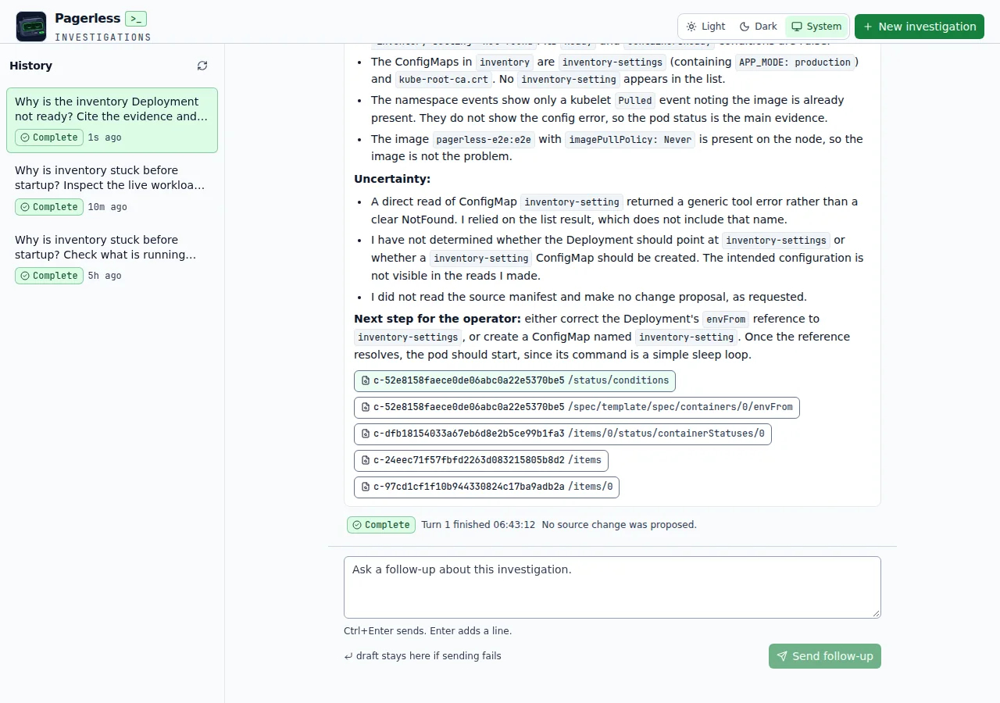
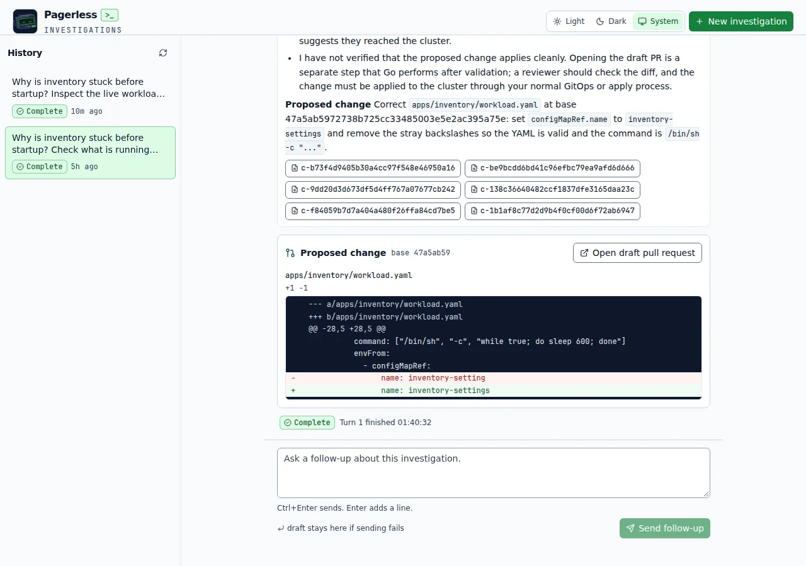
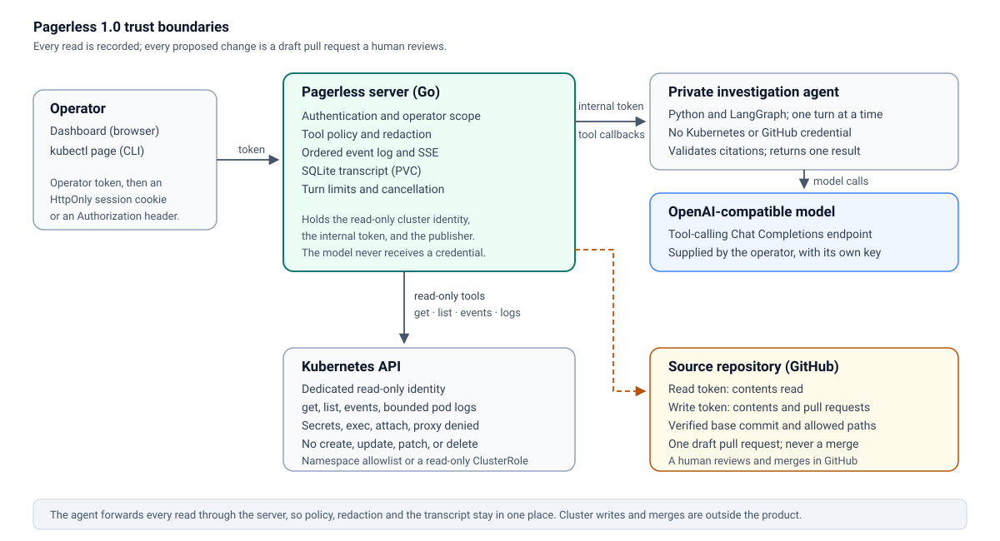

<p align="center">
  
</p>

<h1 align="center">Pagerless</h1>

<p align="center"><strong>An open-source AI SRE agent for Kubernetes.</strong></p>

<p align="center">
  Deploy it in your cluster. Ask from the CLI, the dashboard, or an observability alert.
  It investigates with read-only tools, cites every claim, and opens a draft pull request for the fix.
</p>

<p align="center">
  <a href="https://github.com/a-hagi613/pagerless/actions/workflows/ci.yml"></a>
  <a href="https://github.com/a-hagi613/pagerless/releases/latest"></a>
  <a href="LICENSE"></a>
  
  
</p>

Pagerless runs as a namespace-scoped service inside the cluster. It exposes a CLI, a browser
dashboard and an MCP endpoint over one investigation API. A turn reads the cluster and the
repository that owns its configuration, records every tool call, and returns an answer with
citations. When the evidence supports a source change it creates a branch and a **draft** pull
request. It never writes to the cluster and never merges.

## CLI

The CLI is the shortest path from an alert to an answer.

```sh
kubectl --namespace pagerless get secret pagerless-credentials \
  --output jsonpath='{.data.operator-token}' | base64 --decode |
  kubectl page "Why is the inventory Deployment not ready?" -n inventory --token-file -
```

The command prints the page and turn IDs, then each tool call as it happens, the cited answer and
a coloured diff when a proposal exists. The operator token is read from standard input or from
`PAGERLESS_TOKEN_FILE`; it is never a command-line value.

https://github.com/user-attachments/assets/9ffda7da-f6ba-4576-a6cd-07523c49d270

*Recorded against a live installation: a Claude Haiku turn, read-only tool calls, citations and
the proposed one-line diff.*

```text
page 6f4c... turn 2b8e...
-> resources_get (call c-4a3e...) {"kind":"Deployment","name":"inventory","namespace":"inventory"}
<- resources_get (call c-4a3e...) ok 18ms
-> resources_list (call c-6ba9...) {"kind":"Pod","labelSelector":"app=inventory","namespace":"inventory"}
<- resources_list (call c-6ba9...) ok 5ms
...
The Deployment references ConfigMap `inventory-setting`, which does not exist.
The namespace contains `inventory-settings`. The source manifest has the same mismatch.
citation: c-4a3e... /spec/template/spec/containers/0/envFrom

Pull request: https://github.com/your-org/your-cluster-config/pull/42
```

`kubectl page list`, `show`, `follow`, `activity`, `evidence`, `diff`, `reply` and `stop` operate
on the same page history as the dashboard. Ctrl-C detaches the stream; `kubectl page stop` cancels
the turn.

## Dashboard

The dashboard is the same investigation with a browser UI: an activity timeline, sanitized
evidence dialogs, cited Markdown answers and the proposed diff.

https://github.com/user-attachments/assets/44875625-1ea1-4eab-8bc5-f0606b5c7a32



<table role="presentation">
  <tr>
    <td width="50%">
      
    </td>
    <td width="50%">
      
    </td>
  </tr>
</table>

Open the port-forward, sign in with the operator token, and start a question with an optional
namespace or resource hint. The sign-in exchanges the token for an HttpOnly, SameSite=Strict
session cookie; the token is not written to browser storage.

```sh
kubectl --namespace pagerless port-forward service/pagerless-server 8080:8080
```

## Draft pull requests

A proposal is a branch and a draft pull request against the repository configured at install time.
Pagerless verifies the repository, base commit and allowed path before writing, then includes the
question, findings, evidence references and expected effect in the PR body. It never pushes to the
default branch, never force-pushes and never merges. A human reviews the diff and decides.


## Observability MCP

Pagerless connects to Prometheus and Grafana through MCP and admits only read tools:

| Integration | Tools |
| --- | --- |
| Prometheus | `prometheus_query`, `prometheus_alerts`, `prometheus_targets` |
| Grafana | `grafana_alerts`, `grafana_dashboards`, `grafana_dashboard`, `grafana_datasources` |

Enable either integration in `values.yaml`:

```yaml
observability:
  prometheus:
    enabled: true
    url: http://kube-prometheus-stack-prometheus.monitoring.svc:9090
    # tokenSecretKey: prometheus-token
  grafana:
    enabled: true
    url: http://kube-prometheus-stack-grafana.monitoring.svc:80
    tokenSecretKey: grafana-token
```

The chart deploys one read-only MCP process per integration. The server admits the tools through
the same policy, redaction and transcript as the Kubernetes and GitHub integrations.

Add the Grafana service-account token under the `grafana-token` key of the installation Secret.
Prometheus needs a token only when its endpoint requires one; name that key in
`observability.prometheus.tokenSecretKey`.

### Automatic investigations

The server exposes an authenticated MCP endpoint at `/mcp`. An observability MCP bridge or
Alertmanager integration can start an investigation without a human in the loop:

```json
{
  "jsonrpc": "2.0",
  "id": 1,
  "method": "tools/call",
  "params": {
    "name": "pagerless_investigate",
    "arguments": {
      "question": "Investigate the firing ContainerOOMKilled alert for inventory",
      "namespace": "inventory",
      "target": { "kind": "Deployment", "name": "inventory" },
      "idempotencyKey": "grafana-alert-8f2c1a"
    }
  }
}
```

`pagerless_investigate` creates a page and starts the turn. The same parameters can be delivered
as `notifications/pagerless/investigate` for push-style MCP bridges. The endpoint authenticates
with the trigger token in the installation Secret:

```sh
kubectl --namespace pagerless get secret pagerless-credentials \
  --output jsonpath='{.data.trigger-token}' | base64 --decode
```

The Alertmanager/Grafana alert rules and dashboards used by the acceptance environment live in
[`pagerless-sandbox`](https://github.com/a-hagi613/pagerless-sandbox). The shipped rules carry the
`pagerless.dev/watch: "true"` opt-in and the namespace/deployment labels the bridge forwards.

## Architecture



- **Server** — authenticates operators and the MCP trigger, enforces tool policy, redacts results,
  stores the transcript and streams ordered events.
- **Agent** — a private service that calls an OpenAI-compatible model and forwards tool calls back
  through the server. It holds no Kubernetes, GitHub or model credential.
- **MCP integrations** — read-only Kubernetes, GitHub, Prometheus and Grafana processes.
- **Publisher** — the only component with a GitHub write token; it creates branches and draft PRs.

The Kubernetes identity can get, list, watch events and read bounded pod logs. Secrets, exec,
attach, proxy and every mutating verb are denied. The agent never receives a cluster credential.

## Install

Requirements: Kubernetes 1.29 or newer, Helm 3.14+, an OpenAI-compatible tool-calling model, a
GitHub repository for the cluster's source configuration, and a 5 GiB StorageClass (or an existing
claim).

### 1. Credentials

The chart never creates a Secret. Create the namespace and one Secret:

```sh
kubectl create namespace pagerless

read -rsp 'Model API key: ' PAGERLESS_MODEL_KEY; echo
read -rsp 'GitHub read token: ' PAGERLESS_GH_READ; echo
read -rsp 'GitHub write token: ' PAGERLESS_GH_WRITE; echo

kubectl --namespace pagerless create secret generic pagerless-credentials \
  --from-literal=operator-token="$(openssl rand -hex 32)" \
  --from-literal=trigger-token="$(openssl rand -hex 32)" \
  --from-literal=internal-token="$(openssl rand -hex 32)" \
  --from-literal=mcp-token="$(openssl rand -hex 32)" \
  --from-literal=github-read-token="$PAGERLESS_GH_READ" \
  --from-literal=github-write-token="$PAGERLESS_GH_WRITE" \
  --from-literal=model-api-key="$PAGERLESS_MODEL_KEY"

unset PAGERLESS_MODEL_KEY PAGERLESS_GH_READ PAGERLESS_GH_WRITE
```

| Secret key | Used by | GitHub permission |
| --- | --- | --- |
| `github-read-token` | GitHub MCP reader | Contents: Read |
| `github-write-token` | Publisher | Contents: Read and write, Pull requests: Read and write |
| `operator-token` | CLI and dashboard | — |
| `trigger-token` | Observability MCP bridge | — |

### 2. Values

```yaml
existingSecret: pagerless-credentials

model:
  baseUrl: https://api.anthropic.com/v1
  name: claude-haiku-5-5

github:
  repository: your-org/your-cluster-config
  baseBranch: main
  # pathPrefix: clusters/production

kubernetes:
  # One read-only Role per namespace; empty grants read-only access cluster-wide.
  namespaceAllowlist: [shop]

# Optional observability MCP integrations.
observability:
  prometheus:
    enabled: false
    url: http://kube-prometheus-stack-prometheus.monitoring.svc:9090
  grafana:
    enabled: false
    url: http://kube-prometheus-stack-grafana.monitoring.svc:80
    tokenSecretKey: grafana-token
```

### 3. Install

```sh
helm install pagerless \
  oci://ghcr.io/a-hagi613/pagerless/core/charts/pagerless \
  --version 1.1.0 \
  --namespace pagerless \
  --values values.yaml
```

The chart falls back to the release asset when OCI is not anonymously readable:

```sh
helm install pagerless \
  https://github.com/a-hagi613/pagerless/releases/download/pagerless-v1.1.0/pagerless-1.1.0.tgz \
  --namespace pagerless \
  --values values.yaml
```

`/readyz` names any missing prerequisite. The service stays unready until the model accepts a
tool-calling probe and the repository is readable with the configured credentials.

## Security model

- One read-only Kubernetes identity. Discovery never extends the admitted kinds; Secrets and every
  write verb are refused before the API call.
- Model output, logs and repository files are untrusted. Results are bounded, redacted and rendered
  as text or safe Markdown; the dashboard never injects HTML.
- Credentials are projected Secret files, read per request and never placed in flags, URLs, logs or
  the transcript.
- The agent is a separate service with an internal token and no cluster, GitHub or model credential.
- The publisher is a separate code path with the GitHub write token. It only creates branches and
  draft pull requests.

## Documentation

- [Investigation API](docs/investigation-api.md) — pages, turns, events, evidence and publication.
- [Architecture decision](docs/adr/0001-investigation-service.md) — runtime and permission boundaries.
- [Release engineering](docs/release.md) — immutable tags, publication and anonymous access.
- [Demo and verification](docs/demo.md) — recorded environment and acceptance evidence.
- [Release notes](docs/release-notes/1.1.0.md) — coordinates and changes for this release.

## Development

```sh
make dashboard-check   # typecheck, lint and unit tests
make test              # Go and Python suites
make validate          # Helm lint, render and kubeconform
make verify-chart      # packaged chart on kind, including the MCP integrations
make lint              # go vet, golangci-lint, ruff and mypy
```

`make verify-chart` creates and deletes its own kind cluster. No maintainer model key or cloud
account is required for CI.

## License

Apache-2.0. Pagerless is maintained by [a-hagi613](https://github.com/a-hagi613).
