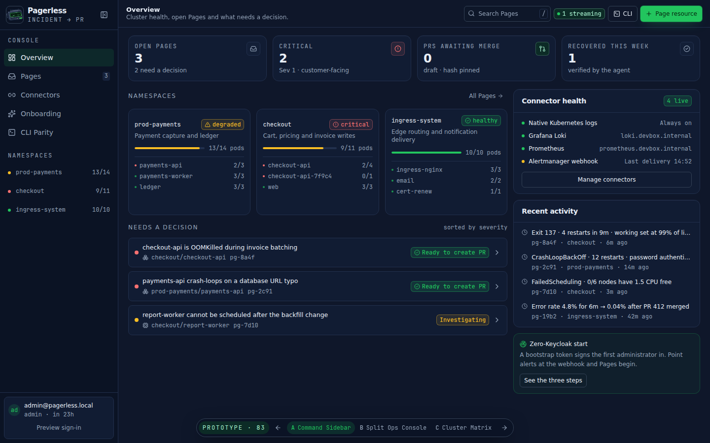
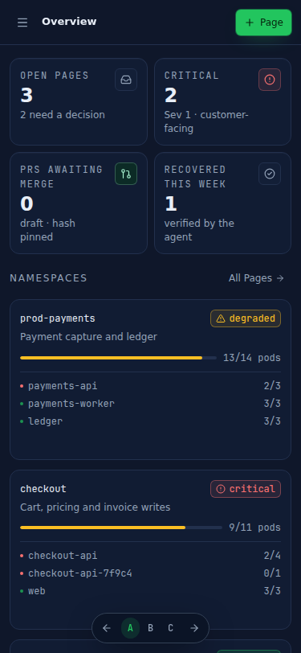
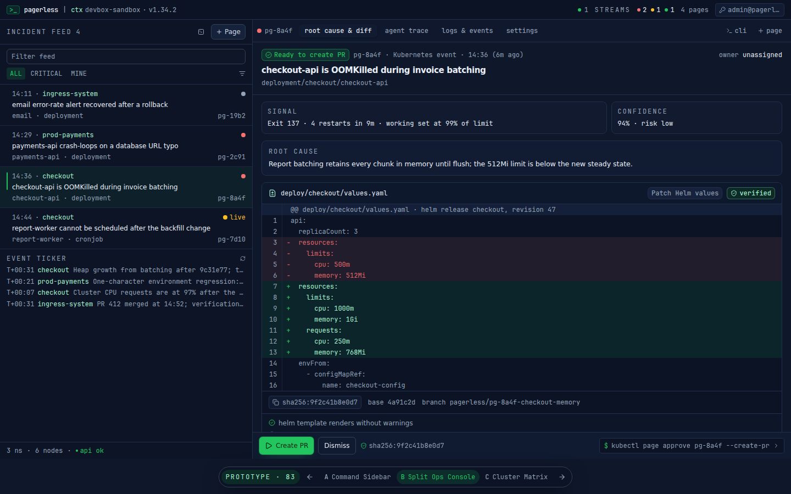
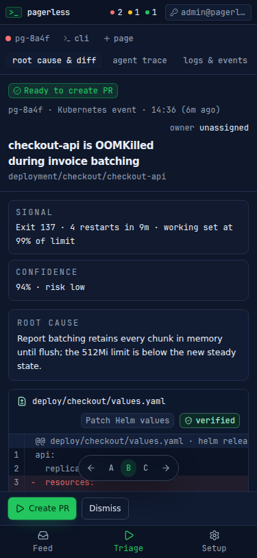
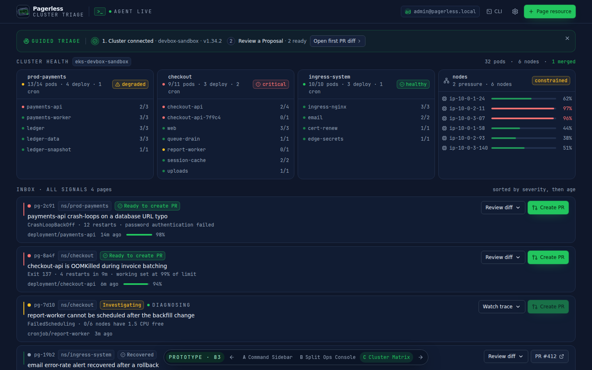
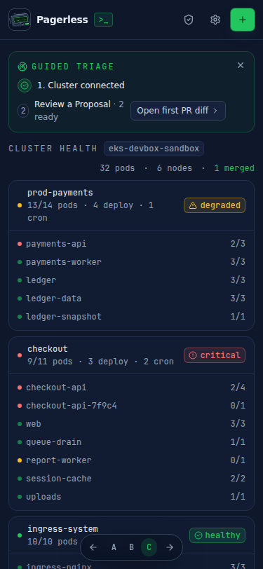

# Ticket 83 — Pagerless v2 portal prototype

**Throwaway artifact.** Branch `prototype/v2-shadcn-portal`, no pull request by design
(`prototype/SKILL.md` rule 6). Nothing in `dashboard/src/prototype` is production code: the data is in
memory, there is no API, no authentication and no persistence. The winning ideas get rewritten when they
are folded into the real dashboard.

- Issue: [Prototype the mobile-responsive shadcn/ui portal and retro pager brand with impeccable](https://github.com/a-hagi613/pagerless/issues/83)
- Branch: <https://github.com/a-hagi613/pagerless/tree/prototype/v2-shadcn-portal>
- Question: with `impeccable` 0.1.18, official shadcn/ui patterns, the retro pager `>_` mascot and the
  Midnight/Slate/Green/Mint palette, what should the Pagerless v2.0 portal look like and how should it
  behave on desktop and on a 375 px phone?

## Running it

```sh
cd dashboard
npm ci
npm run build
npm run preview -- --port 8080
# http://localhost:8080/?variant=A   (or B, C)
```

`/` boots straight into the live prototype. There is no `/login` redirect and no backend call: the v1
console moved to `/start` and `/triages/...` behind its original session provider. Switch variants with
the floating bar or the `←` / `→` keys, which write `?variant=` through `useSearchParams` and ignore
keystrokes inside inputs. Arrow keys do not fire while a sheet or dialog is open.

## What is simulated

Everything a variant shows comes from `dashboard/src/prototype/data.ts`; the store in `store.tsx` keeps it
in memory. Three behaviours are genuinely interactive, not mock-ups:

| Interaction | What happens |
| --- | --- |
| **Create PR** | Pins PR #418 (or an existing number) to the Page, moves it to `PR open · awaiting merge`, appends a `gh pr create` Finding, and raises a toast. |
| **Dismiss** | Marks the Page `Dismissed`, keeps the trace for audit, and closes the detail surface. |
| **Page resource** | Creates a new Page from the dialog, then streams one scripted Finding every 1.8 s. When the queue drains and a Proposal exists, the Page turns `Ready to create PR`. This is how a newly paged workload becomes reviewable without a server. |

Trace streaming also runs on the `report-worker` Page (`pg-7d10`) as soon as the portal loads, so the
"live" states are observable without clicking anything.

## The three variants

Each variant is a complete answer to the layout question, not a theme: they disagree about navigation,
information hierarchy, the primary affordance, and the mobile structure. All three share the dataset,
the status vocabulary, the diff renderer, the trace renderer, the onboarding form, the CLI drawer, the
sign-in preview and the toaster. They do not share a layout.

### A — Command Sidebar (shadcn dashboard-01)

A collapsible 240 px shadcn `sidebar` rail (Overview, Pages, Connectors, Onboarding, CLI Parity) with
namespace shortcuts, a sticky top bar with search and Page action, a four-card KPI strip, namespace health
cards, and a filterable/searchable `table` of Pages. A row opens a right-hand `sheet` with Root cause /
Agent trace / Diff tabs and a sticky decision footer. Below `lg` the rail becomes a left drawer and the
table becomes cards.

Primary affordance: browse and filter the list, then work in the slide-over.




### B — Split Ops Console

No page scroll: a 36 px status line, a fixed 32 % incident feed with its own filter, live Page list and
event ticker, and a full-height tabbed workspace (root cause & diff, agent trace, logs & events, settings)
with a sticky `Create PR` footer that also shows the pinned hash and the equivalent `kubectl page` verb.
The logs tab is a raw, monospaced console with source filters instead of the collapsible trace used
elsewhere. On mobile it becomes three bottom-nav panes (Feed, Triage, Setup); the prototype bar lifts
above the nav.

Primary affordance: watch the feed, act in the workspace without leaving it.




### C — Cluster Health Matrix & Guided Triage

A horizontal header with the `>_` mark and a live agent indicator, a dismissible two-step quickstart
(1. cluster connected / 2. review a Proposal), a clickable health matrix of the three namespaces plus the
node pool, and a severity-ordered inbox whose cards expand inline into root cause + trace + diff +
Create PR. Clicking a namespace or node tile filters the inbox; a red tile is the filter control, not
decoration.

Primary affordance: start from cluster shape, narrow to the failing workload, decide inline.




## Shared surfaces

- **Preview sign-in** (`dialog`, all variants): a zero-Keycloak bootstrap-token exchange with
  administrator / on-call engineer / read-only auditor roles, a masked token field and the matching
  `kubectl page login --token-stdin` command. No redirect, no network.
- **CLI equivalent** (`sheet`, all variants): every portal verb with a copy button. When a Page is in
  context the drawer adds a "This Page" tab (`get`, `diff`, `approve --create-pr`, `dismiss`).
- **Onboarding**: three numbered sections — AI endpoint (base URL, model, masked `pagerless-ai` key,
  test button), GitHub repository (owner/repo, masked PAT with scopes, auto-draft switch), connectors
  (native K8s logs always on, Loki, Prometheus, CloudWatch, Datadog, Alertmanager webhook with copy).
- **Page resource** (`dialog`): namespace/workload picker, hint, and the equivalent `kubectl page new`
  command; creating one reveals it in the current variant (sheet, workspace, or inline card).

## Design decisions

| Decision | Value | Why |
| --- | --- | --- |
| Canvas | Midnight `#0F172A` | Dark-first pager console; light tokens kept complete so the browser preference can still be honoured. |
| Card / rail steps | `#111C33`, `#16223B`, rail `#0B1324` | Three close Midnight steps carry depth without shadows. |
| Borders | Slate `#334155`, subtle `#22304D` | Crisp 1 px structure; no gradients or glass on data surfaces. |
| Primary | Green `#22C55E` on `#06240F` ink | One action colour: Create PR, healthy signals, focus ring. |
| Accent | Mint `#A7F3D0` | Terminal output, diff additions, verified checks, `>_` marks. |
| Type | System sans + `JetBrains Mono`/`ui-monospace` | Pod names, hashes, diffs, logs and commands are monospaced; no webfont fetch. |
| Type floor | 12 px for every functional or body string | `impeccable` flagged 10–11 px meta text; raised across the prototype rather than suppressed. |
| Live affordance | Static status dot + `LIVE` / `STREAMING` label | A pulsing dot and then a blinking caret were both flagged as decorative; the trace visibly grows every 1.8 s instead, which is the honest signal. |

Other fixes from the detector pass: the mascot tile's zero-offset green glow was removed, and every
`text-muted-foreground/40…80` opacity that dropped below 4.5:1 was replaced with the full token.

## Brand assets

Generated from the Wayfinder mascot source with Pillow (border-connected backdrop key that also removes
the soft drop shadow, one-pixel erosion against the JPEG fringe, LANCZOS resize; the icon tile is a
rounded Midnight square with a Slate rim, drawn at 4× and downsampled):

| Asset | Size | Use |
| --- | --- | --- |
| `docs/assets/pagerless-mascot.png` | 512×512 RGBA | transparent mascot for docs |
| `docs/assets/pagerless-icon.png` | 256×256 RGBA | rounded Midnight app icon |
| `dashboard/public/favicon.png` | 64×64 RGBA | favicon |
| `dashboard/public/pagerless-mascot.png` | 256×256 RGBA | in-app marks |

`dashboard/index.html` now links `/favicon.png`, sets `color-scheme: dark` and
`<html class="dark">`, and titles the page `Pagerless — Kubernetes Incident & PR Portal`.

## Verification

```
$ cd dashboard && npm ci          # 235 packages, 0 vulnerabilities
$ npm run typecheck               # pass
$ npm run lint                    # pass (react-hooks + react-refresh clean)
$ npm run build                   # pass: 583.86 kB js (172.30 kB gzip), 50.83 kB css (9.68 kB gzip)
```

The single build warning is the >500 kB chunk advisory, expected for a prototype that bundles three
variants and Radix primitives.

`impeccable detect` (0.1.18, local scan only):

```
$ impeccable detect dashboard/src                    # 0 anti-patterns, exit 0
$ impeccable detect http://127.0.0.1:8081/?variant=A # 1440×900 and 390×844: 0, exit 0
$ impeccable detect ...?variant=B                    # 1440×900 and 390×844: 0, exit 0
$ impeccable detect ...?variant=C                    # 1440×900 and 390×844: 0, exit 0
```

An earlier pass reported 70/77/89 findings (undersized text, low-contrast muteds, dark glow, pulsing
dots, one unbalanced mobile heading); all were fixed in code except the pulse, which was replaced by the
data itself, so the final runs are clean with no advisory notes. A local Playwright script then exercised
the flows — boot without login, arrow-key switching, keystrokes not hijacking variants, filtering,
Create PR, CLI drawer context, role switching, guided expand, new-Page streaming to reviewable, B
settings and footer — with 15/15 assertions passing and no console errors.

## Files

New: `dashboard/src/prototype/**` (portal, switcher, store, fixtures, three variants, shared surfaces),
`dashboard/src/components/ui/{sheet,table,tabs,dialog,separator,tooltip,collapsible,switch,sidebar,sidebar-context}.tsx`,
`docs/prototypes/`, regenerated brand PNGs.
Changed: `dashboard/{index.html,package.json,package-lock.json,src/index.css,src/App.tsx,src/main.tsx}`,
the five existing shadcn primitives (tokenised), `docs/assets/pagerless-{mascot,icon}.png`.
Dependencies added, pinned exactly: `@radix-ui/react-dialog@1.3.1`, `react-tabs@1.2.1`,
`react-tooltip@1.4.1`, `react-separator@1.2.0`, `react-switch@1.4.1`, `react-collapsible@1.2.1`.

## Open questions for the review

1. Does the product want the incident **table** (A), the **feed/workspace** split (B), or the **matrix-first**
   inbox (C) as the default surface? A is the safest shadcn baseline; B best matches an on-call posture; C
   best sells the cluster-health story.
2. Is a 240 px rail affordable on a 13-inch laptop once the diff viewer opens? B's answer is no.
3. Should the Page detail live in a sheet (A), in place (B/C), or at its own route? The route is omitted
   here on purpose: it adds navigation chrome to every variant.
4. The bootstrap-token sign-in is a preview surface only; the real flow still needs an ADR for token
   rotation and audit.

## Cleanup when the decision is made

Delete `dashboard/src/prototype`, `docs/prototypes`, revert `App.tsx`/`main.tsx` to the session shell and
restore the primitives' v1 tokens; keep the brand PNGs and `index.html` changes if the palette wins.
